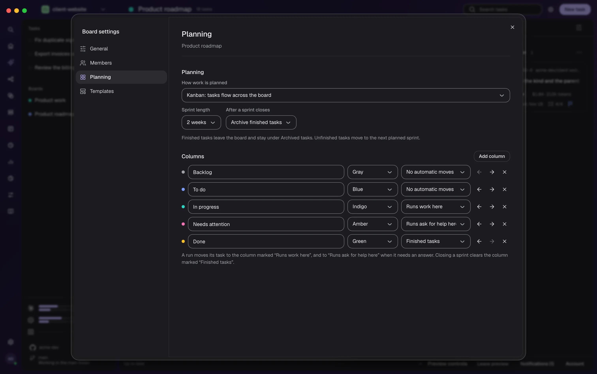
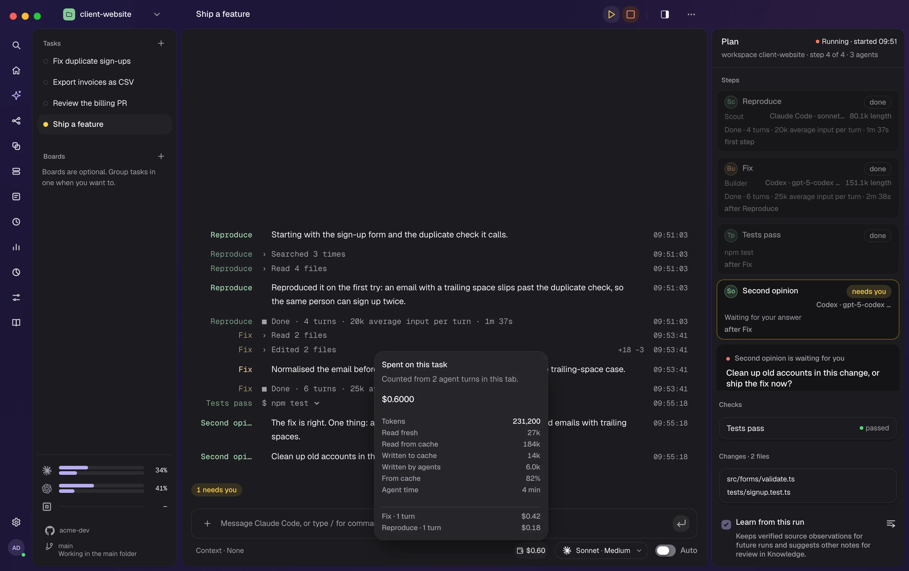
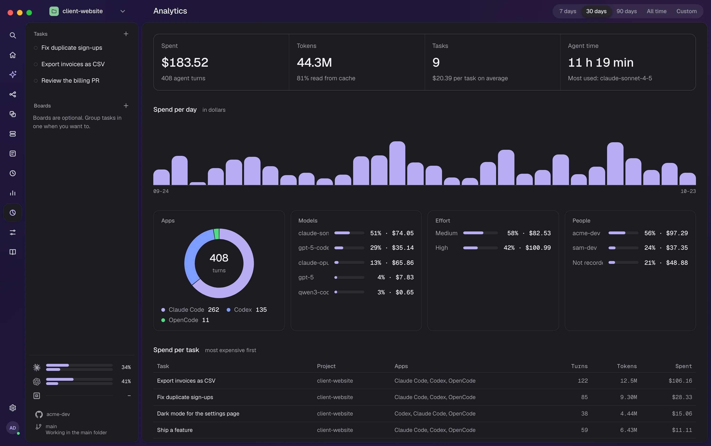

# Using RigOne

RigOne is a Mac app where coding agents — Claude Code, Codex and OpenCode — work for you as a team.
You give them a job, they work in their own copies of your code, RigOne checks the result, and you
decide what to keep. This guide describes RigOne 1.13 and the latest updates.

New here? Start with [Getting started](#getting-started), then follow the
[tutorial](#tutorial-your-first-run-step-by-step). Everything else you can read when you need it.

## Getting started

Install RigOne and open it for the first time. It takes about five minutes.

### What you need

- A Mac with **Apple Silicon** and **macOS 13** or later.
- At least one agent app, installed and signed in: **Claude Code**, **Codex** or **OpenCode**.
  RigOne starts them for you, and runs use your own plan with each vendor.
- A project folder on your Mac, usually a Git repository.

### Install

1. Download `RigOne_<version>_aarch64.dmg` from the
   [latest release](https://github.com/monoone-dev/rig-one-landing-page/releases/latest).
2. Open the DMG and drag **RigOne** into **Applications**.
3. Open RigOne from Applications.

The app is signed with Apple Developer ID and notarized by Apple. If macOS says it "cannot be
opened" or "is damaged", do not work around it: delete the file, download it again, and
[open an issue](https://github.com/monoone-dev/rig-one-landing-page/issues/new) if it happens
again. After the first install, RigOne [updates itself](#updating).

### Check the download (optional)

Each release lists the SHA-256 of its DMG. In Terminal:

```bash
shasum -a 256 ~/Downloads/RigOne_<version>_aarch64.dmg
spctl --assess --type open --context context:primary-signature -v ~/Downloads/RigOne_<version>_aarch64.dmg
```

The first line must match the checksum in the [changelog](https://rig-one.io/changelog/). The
second must say `accepted` and `source=Notarized Developer ID`.

### First launch

RigOne finds your agent apps on its own. To see that everything works, open **Settings → Health
check**: each row says **OK**, **Attention** or **Optional**, with a button to fix what does not
work.


macOS asks for permissions the first time RigOne needs them — for example access to your project
folders and notifications. The app follows your macOS language and speaks nine languages; change it
in **Settings → Appearance**. This guide uses the English names of buttons and screens.

## Tutorial: your first run, step by step

From an empty RigOne to a finished run, and then a whole goal handed to Auto. Any folder with code
works. Plan on about fifteen minutes, most of it watching the agents.

### Step 1: open a project

Open the project menu at the top of the side panel and choose **Add a workspace**. Give it a
**Name**, press **Choose folder**, pick your project and press **Save**. RigOne opens a new task
that asks **What should I do?**


If no agent app says **OK** in **Settings → Health check**, run `claude`, `codex` or `opencode`
once in Terminal to sign in, then press **Run again**.

### Step 2: make an agent with one job

Open **Agents** (⌘1) and press **Create agent**. Give it a **Name**, a one-line **What it does**
and **Instructions** in your own words. On the **Model** tab pick Claude Code, Codex or OpenCode
with a model and effort. On **Access**, keep **Look only** unless the agent has to write code.


For a first workflow, make three agents: one that finds the cause, one that writes the fix, and a
reviewer. Prefer to edit rather than write? **Create from description** drafts an agent from one
sentence.

### Step 3: put agents in a row

Open **Workflows** (⌘2) and press **Create workflow**. Use **Add** on the canvas to place a step for
each agent, and draw arrows between them. An arrow means "runs after" — nothing else. Two steps
after the same step start together.


After the step that changes code, add **A step that runs a check** with the command that proves the
work, such as `npm test`. RigOne runs it itself; the agent does not get to say it passed.

### Step 4: start the run

Open a task in **Tasks** (⌘3) and type `/run` with the workflow's name, or press **Show workflow**.
The plan on the right lists every step and what it waits for. **Run options** (⋯) sets how many
**Agents** may work at once. Press **Run workflow**.


Before the first step starts, RigOne checks the whole graph and tells you if a step's model,
effort or permissions will not work — so no time or money is spent on a run that cannot finish.

### Step 5: watch, and answer when asked

The middle of the screen shows what every agent says and does. The plan shows each step's state.


When an agent asks something, the question appears with numbered answers. Everything that does not
depend on your answer keeps going. **Stop** ends every agent of the run.

### Step 6: take the result

Each step ends **done**, **failed**, **stopped** or **not run**. Everything the agents changed waits
on its own branch in your project — nothing reaches your own branch until you merge it. Review the
branch as you would a colleague's.

If **Learn from this run** was on, open **Knowledge** and press **Keep** on the notes worth keeping.

### Step 7: hand a whole goal to Auto

Press **＋** next to **Tasks** (⌘N), choose **Auto**, write the goal in one sentence and press
**Run**.


The Lead picks the agents, builds workflows for each part of the goal and keeps going until checks
and reviews prove the work. Questions for you collect in **Needs you**. Read [Auto](#auto) before
you give agents full access in a project you care about.

### Tips

- **One job per agent.** Small agents are easier to reuse and to fix.
- **Only the writer writes.** Keep readers and reviewers on **Look only**.
- **Prove every change.** Put a check after each step that changes code.
- **Mix vendors.** A second opinion from another vendor catches what one model misses.
- **Watch the cost.** The spend beside the model shows what a task has cost so far; see
  [Analytics and costs](#analytics-and-costs).
- **Let RigOne draft the setup.** [Generate project setup](#generate-project-setup) proposes agents
  and workflows from your repository.

## Concepts

The same words appear on screen, in messages and in this guide.

| Word | Meaning |
| --- | --- |
| **Project** | A folder on your Mac, added as a workspace. |
| **Agent app** | The program that does the work: Claude Code, Codex or OpenCode. |
| **Agent** | A role: one job, its instructions, an agent app, a model and permissions. |
| **Workflow** | A saved graph of steps you can run again. |
| **Step** | One tile in a workflow. An arrow between steps means "runs after". |
| **Task** | One line of work in the side panel: a conversation, a run or an Auto goal. |
| **Run** | One execution of a workflow. |
| **Check** | A command RigOne runs itself to see whether the work holds. |
| **Lead** | The agent you talk to in a task. It prepares; `/run` or Auto starts work. |
| **Auto** | The Lead plans, runs and verifies a whole goal for you. |
| **Needs you** | One list of every decision waiting for you. |
| **Note** | Something learned in a run, used in future prompts once you approve it. |
| **Skill** | Instructions an agent uses when they fit, kept in a `SKILL.md` file. |
| **Context set** | Material — text, images, PDFs — prepared for the steps that need it. |
| **Connection** | A tool server an agent may use, such as a browser or an issue tracker. |
| **Board** | A shared list of work items — epics, features, stories, tasks and bugs — encrypted on your Mac. |
| **Spend** | What agents cost, counted per task, per board item and in Analytics. |

## The window

On the left is a narrow **rail** of icons, then the **side panel** with your tasks and boards, then
the screen you opened. With two or more projects open, project tabs run along the top.


### The rail

Point at an icon to see its name.

| Place | Shortcut | For |
| --- | --- | --- |
| **Search** | ⌘K | Jump to any place, workflow or agent |
| **Home** | — | A fresh new task |
| [Generate project setup](#generate-project-setup) | — | Draft agents and workflows from your repository |
| [Workflows](#workflows) | ⌘2 | Steps in a row, on a canvas |
| [Agents](#agents) | ⌘1 | The roles that do the work |
| [Knowledge](#knowledge) | ⌘5 | Notes and skills that go into prompts |
| [Context](#context) | ⌘6 | Material prepared for steps |
| [Triggers](#triggers) | ⌘4 | Runs that start on their own |
| [Lab](#lab) | ⌘7 | Test agents on your own cases |
| [Analytics](#analytics-and-costs) | — | What agents spent, and on what |
| [Overview](#overview) | G P | The whole project on one page |
| [Skills](#skills) | — | The skills your project gives its agents |
| [Settings](#settings) | ⌘8 | Defaults for runs, Auto, projects and the app |

[Tasks](#tasks) (⌘3) and [Boards](#boards) (⌘9) open from the side panel.

### The side panel

- **The project menu** at the top switches workspaces and adds new ones.
- **Tasks** lists your tasks; a coloured dot shows **Working**, **Needs you**, **Done**, **Failed**
  or **Stopped**. **＋** (⌘N) starts a new one. Tasks come back after a restart.
- **Boards** lists your boards.
- **Plan limits** at the bottom show how much of each agent app's plan is used.
- Below that: which folder RigOne works in and which GitHub account it uses.


## Projects side by side

Every project you open becomes a tab. Up to three projects can sit side by side in one tab, each
with its own tasks and runs — a run keeps going in one while you work in another.


- **⌘⌥\\** shows another project beside the one you are in.
- **Drag a tab** onto another to join them, or onto the empty strip to take it out.
- **Drag the edge** between panes to resize; a double-click shares the width evenly.
- A dot on a tab says whether the project is working or waiting for you.

Tabs and panes come back after a restart.

## Search and keyboard shortcuts

**⌘K** opens **Go to anything**: type part of a name to jump there, start a conversation or run a
workflow. Press **?** anywhere outside a text field for every shortcut.

| Keys | Does |
| --- | --- |
| ⌘K | Go to anything |
| ⌘N | New task |
| ⌘1 … ⌘9 | Agents, Workflows, Tasks, Triggers, Knowledge, Context, Lab, Settings, Boards |
| G, then a letter | Go to a place, such as G A for Agents or G P for Overview |
| ⌘⌥\\ | Show another project beside this one |
| ⌘⌥1 … ⌘⌥9 | Pick a project tab |
| ⌘U | Add files or photos to your message |
| Esc | Close |

## Tasks

**Tasks** is where you give work to agents: talk to the Lead, run a workflow, hand a goal to Auto
and answer what agents ask.

### A new task

Write what you want under **What should I do?** and pick how it runs:

- **Auto** — RigOne picks the agents and works until the goal is verified. See [Auto](#auto).
- **Plan first** — RigOne writes a task list first; nothing runs until you start it.
- **One agent** — one agent works on it in this folder.


Under the field:

- **＋** adds files or photos (⌘U) or a folder. You can also drag them onto the field.
- **Context** attaches a context set.
- The pill on the right picks the agent app, model and effort. The amount beside it is what this task
  has spent so far.
- The board icon files the task on a board.


### Talking to the Lead

The field at the bottom talks to the Lead. It can explain, plan and prepare; real work starts with
`/run` or in Auto. A message sent while it works joins its current turn. Each reply shows the model
and effort that wrote it. While an agent works, **Stop** takes the place of **Send**.

| Command | Does |
| --- | --- |
| `/run` | Start a workflow |
| `/ask` | Start one agent |
| `/tasks` | Break the goal into tasks you review before anything runs |
| `/history` | What has run in this folder |
| `/stop` | Stop the run that is going |

Type `/` for every command and skill, and **@** to point at a place in the project.

### Running a workflow

Type `/run` or press **Show workflow** in a task's header. **Run options** (⋯) sets how many
**Agents** may work at once — independent steps really do run in parallel up to that number. Press
**Run workflow**.

Before any step starts, RigOne checks every step's model, effort and permissions, and names the step
that will not work. If you want a heads-up about cost, turn on **Warn about spending** in
[Settings → Runs](#runs). RigOne warns; it does not stop the run.

### Watching a run

- **The stream** in the middle shows what each agent said, in order. Each command an agent ran folds
  under its line; click the arrow to see the command and its output.
- **The plan** on the right shows every step's state and what it waits for. Click a step to open it.
- **Questions** appear at their step with numbered answers. Everything else keeps going.
- **Outcomes** are honest: **done**, **failed**, **stopped** or **not run**.

**Settings → Appearance → Conversation view** shows the stream as a **Terminal** log or as **Agent
chat** bubbles. When a provider is busy or a usage limit is reached, the step waits and carries on.

### Stopping

**Stop** ends every running agent and checks that the processes are really gone. **Interrupt**
stops only what the Lead is doing now, so it can answer you.

## Auto

Give the Lead a goal in one sentence. It picks the agents and skills it needs, builds a workflow for
each part of the goal, runs them and keeps going until every part is verified. You can keep talking
to it while it works.


- **RigOne decides when work is done, not the Lead.** A part counts as done only when checks and
  a review prove it.
- **Agents & work** on the right shows every part of the goal under **Needs attention**, **In
  progress**, **Up next** and **Finished**. Open a part to see what it does, what went wrong and how
  long is left.
- **Goals are saved.** A stopped goal can be resumed later, and a running goal carries on after
  RigOne restarts. Up to three goals work in one folder at a time.
- **Results** wait on a branch. Auto can push and open a pull request only when you allow it.
- **A sound** can play when a goal is finished — turn it on in **Settings → Runs**.

### Pause, take over, stop

- **Take over** stops the Lead's current reply; the goal keeps going.
- **Stop ▾ → Pause Auto** starts no new work until you press **Resume**.
- **Stop ▾ → Stop Auto** asks first, then saves the goal where it reached.

### Full access

**Full access for agents (YOLO)** in **Settings → Auto** is on by default: agents skip their own
permission prompts, like when you run them with YOLO in a terminal. Every step still works in its
own copy of your code, and secrets stay out of command lines. Turn it off to let each agent app use
its own safer permission mode. Outside Auto, **YOLO mode** in the model pill makes the same choice
for one conversation.

### Needs you

Every decision that waits for you sits in one list, **Needs you**. Each card says what happens after
each answer. macOS tells you when a decision waits while RigOne is in the background.

| Card | Asks |
| --- | --- |
| **Question** | Something the Lead needs to know |
| **Approval** | Let a part write outside its copy, or take an outward action? |
| **Retry** | Allow one more try? |
| **Design review** | Accept the look of a changed screen, or mark what to change |
| **Failing tests** | Tests outside this goal fail: fix them, update to main, or pause |
| **Usage limit** | Wait for the reset, or use another agent app? |
| **Recorded gap** | Accept a part with a known gap? |

**Design review.** When Auto changes how a screen looks, you see the tester's screenshots first.
Press **I accept**, or **Mark changes**: click a spot, write what should change and **Send
remarks**.

## Boards

**Boards** (⌘9) are shared lists of work — for you, your team and your agents. You plan work on a
board, start it with an agent, and see what it did and what it cost. Boards need a MonoOne account;
**Explore a preview** shows a demo board without one.


- **Encrypted on your Mac.** Items, comments and activity are encrypted before they leave your Mac;
  the server only relays them.
- **Members.** Invite people by email as **Editor** or **Viewer**, and approve every new device.
- **Offline.** Changes wait on your Mac and are sent when the connection returns.

### Kinds of items

Each item has a kind, with its own icon and colour: **Epic**, **Feature**, **User story**,
**Task** and **Bug**. Items nest the way most teams plan:

- an **Epic** holds features,
- a **Feature** holds user stories,
- a **User story** holds tasks and bugs,
- a **Bug** can also stand on its own.

When you create an item, choose its **Kind of item** and where it **Sits under**. An epic, feature or
story lists its **Items inside** and offers to add only the kinds that fit, such as **Add user
story** or **Add bug**.


### Cost on every card

Every card shows what the agents spent on it and the tokens they used — such as `$2.89 · 332.3k
tokens` — even when it is $0.00. A story, feature or epic adds up everything under it, so you see
what a whole feature cost at a glance.

### Board, list and filters

**Board** shows columns you drag cards between; **List** shows the same items as a table. **Filters**
(the icon at the top right) narrows the board to one **Person** or one **Kind**. Each item gets a
short ID such as `PRO-12`.

### Sprints and board settings

**Board settings** (the gear next to **New task**) has a side menu: **General**, **Members**,
**Planning** and **Templates**.

- **Planning** — **How work is planned**: Kanban, where tasks flow across the board, or **Sprints**,
  where you plan work in rounds. Set the **Sprint length**, what happens **After a sprint closes**
  (archive or delete finished tasks), and your **Columns** — name, colour and what each one is for.
- **Templates** — a starting text for each kind, so every new bug or story begins the same way.
- **Members** — who can edit or read the board.



With sprints on, the **Backlog** holds what is not planned yet; **Create sprint**, **Start** and
**Close sprint** move the work along, and unfinished tasks move to the next planned sprint. Only the
owner changes these settings, and every member of a shared board sees the same ones.

### Agents on a board

- **Run with Auto** on a card, or the **Runs** tab of an item, starts it as a workflow or an Auto
  goal in a folder on your Mac. Progress shows on the board for every member.
- **From a conversation.** Ask the Lead to put the work on a board, and it creates the item itself.
- **Agent replies** appear in the item as a thread, apart from what people wrote.
- A question from the agent appears in the item; any editor can answer it there.

## Analytics and costs

RigOne counts what your agents spend — per task, per board item, and over time in **Analytics**. You
always know what a piece of work cost, and where the money and tokens go.

### What a task has spent

The amount beside the model, under the message field, is what this task has spent so far — $0.00
included. Click it to see **Spent on this task**: the exact amount, **Tokens** (read fresh, read
from cache, written to cache and written by agents), how much came **From cache**, **Agent time**,
and what each agent spent.



A step shows its own cost in its header, too (see [Reviewing a step](#reviewing-a-step)).

### The Analytics screen

Open **Analytics** from the rail or with ⌘K. Pick a **Period**: **7 days**, **30 days**, **90
days**, **All time** or **Custom** — click two dates to set a range.



- **The totals** — **Spent**, **Tokens** (with how much was read from cache), **Tasks** (with the
  average per task) and **Agent time** (with the model used most).
- **Spend per day** — a bar for each day in the period.
- **Apps**, **Models**, **Effort** and **People** — how many agent turns went where, and what they
  cost.
- **Spend per task** — every task with its project, apps, turns and tokens, most expensive first.

Good to know:

- A turn whose price RigOne does not know is not in the total, and Analytics says so.
- Lead turns record no person, so they show as **Not recorded** under people.
- On a board, every card carries its own cost — see [Boards](#cost-on-every-card).

## Triggers

**Triggers** (⌘4) start a workflow without you pressing Run. Today the source is **Linear**: an issue
newly assigned to you starts one run.


Press **Create trigger**, then set:

- **Environment variable name** — where your Linear key is. **Test connection** checks it.
- **Workspace** — the folder the run works in.
- **Check every** — 1, 5, 15 or 60 minutes.
- **Workflow** — what runs.

One issue starts one run, even after a restart. Issues already assigned before you create the
trigger do not start runs. Triggers work while RigOne is open.


## Reviewing a step

Click a step in the plan to open it. You see what it was given, what it said, what it changed and
what it cost. Under **Changed lines** it reads like a review in your editor.


- **Comment on a line.** Click a line, write a comment, then **Send comments to the agent**. The
  agent gets one message naming every file and line, and carries on.
- **Open in editor** opens the file at that line in your own editor.
- **Functions changed** lists each changed function and where it is used.
- **Preview this step.** Type your start command — such as `npm run dev -- --port $PORT` — and press
  **Start the app from this step**, then **Open preview**.
- **Saved versions.** RigOne keeps a version after each turn. **Go back to this version** restores
  one, and keeps what is there now too.


If two steps changed the same file differently, nothing is mixed: RigOne names the step and the
files, and keeps both versions.

## Checks and reviews

When a step finishes, RigOne runs the checks itself — it does not ask the agent whether it worked.
You always see three things apart: **what the agent said**, **what the checks found** and **what you
approved**.

- **"Nothing ran" is never a pass.** A green exit code without proof that tests ran does not count.
- **Old failures are not blamed on the change.** A red check runs again on the code without the
  change, to tell old failures from new ones.
- **Flaky tests** outside the change pass with a warning that names them.
- **No repeated work.** A check that already passed on the same code is reused.
- **A clear reason.** A red check says first which tests failed or what stopped it.

A **review** is a step where another agent — often from another vendor — reads the work. In Auto, a
failed review sends the work back for a fix.

## Where the changes go

Each step works in its own copy of your code, so agents never trip over each other. When the run
ends, the work is combined on one new branch in your project.

- A workflow pushes nothing. Only Auto pushes and opens a pull request, and only when you allow it.
- Nothing reaches your own branch until you merge it.
- If two steps changed one file differently, both copies are kept and RigOne tells you where.
- Old copies are cleaned up on their own when the disk runs low (see [Storage](#storage)).

## Safety model

RigOne treats a failed run as a product failure, not terminal noise. It never does these quietly:

- **Clashing changes** stop the next step, and both copies are kept.
- **Stop and timeouts** end the whole process group and check that it is gone.
- **Prompts and secrets** go through stdin, never command-line arguments.
- **Agent environments** are built from an allowlist, unless full access (YOLO) is on.
- **Unknown events** from an agent app are recorded and ignored instead of crashing the run.
- **Files are the source of truth;** the search index can be deleted and rebuilt.

### What leaves your Mac

RigOne runs on your Mac and works in your folders. The agents it starts send what they read to
their own providers, exactly as in a terminal. A trigger talks to Linear with your key. Boards sends
only encrypted data to the MonoOne server, and Remote access connects your phone through the MonoOne
relay. RigOne itself sends no analytics anywhere — the Analytics screen is computed on your Mac.

## Agents

An agent is a role you define once and use in any workflow. **Agents** (⌘1) lists them with their
access, model and effort. Click one to read it; press **Edit** to change it.


### What an agent holds

- **Role** — a **Name**, **What it does** and **Instructions**.
- **Model** — the agent app, model and effort. The list comes from your installed app. You can also
  send it through your own **Model gateway**, or use a local model through Ollama.
- **Access** — **Can it change files**: **Look only**, **Ask first** or **Work freely**. **Can it
  reach the web**: no, or read and search.
- **Give up after** — 10 minutes, 30 minutes or no limit.
- **Skills and connections** — what it may use beyond its instructions.


**Evaluate** tries the agent in the [Lab](#lab). **Duplicate** copies it.

### Create from description

**Create from description** drafts an agent from one sentence. The draft says what it guessed and
why, so you can fix it before you save.

### Bring a setup from another project

**Import setup** reads a project's own agent-app files — `.claude/`, `.codex/`, `.agents/` — and
turns them into RigOne agents, skills and workflows. It only reads files; nothing runs. To copy from
another RigOne project, choose **Import setup from project** in the project menu. Secrets and history
are never copied.


## Workflows

A workflow is what you build on the canvas and run again. **Workflows** (⌘2) lists them with their
steps and how the last run ended. The play button runs one straight away.


### The canvas

Steps are tiles, joined by arrows that mean "runs after". **Add** offers five kinds of step:

- **A step an agent does** — a piece of the work.
- **A step that leaves a command running** — starts your app so later steps can test it.
- **A step that runs a check** — RigOne runs a command and records what it found.
- **A step that asks you** — the run waits for your answer.
- **A way back, to try again** — a loop from a check back to the fix, with a limit.

Two steps after the same step run at the same time. A step with several arrows in reads every
handoff it receives. A step can also run several copies of itself (×3) when you want more than one
take. A badge in the header counts what needs fixing, each with a button that fixes it.

### The step panel

Pick a tile to set it up in the panel on the right: **Who does this**, a **Name** and **What to do**.
More settings — where it works, timeout, what happens **If this step does not pass** — fold away
until you need them. A check step has its **Command to run** and the tests it must confirm.


**Workflow settings** in the header sets which files a fresh copy brings along and the workflow's
context.


## Overview

**Overview** (G P) shows the whole project on one page. **Summary** comes first: six tiles —
**Score**, **Agents**, **Workflows**, **Knowledge**, **Changes** and **Triggers** — and **Needs your
attention**, a short list of what to look at. Tabs hold the details.


- **Score** — how easily agents work in this project; see [Score](#score).
- **Repository** — branch, changes, branches, size on disk and largest folders.
- **Agents** and **Workflows** — with a **Fix** button where something needs a change.
- **Knowledge** — instruction files, skills and new lessons to review.
- **Automation** — triggers and the Auto rules.

**Open in** opens the project in your editor.


### Score

**Score** reads the project and rates, out of 100, how easily agents find their way: where things
live, how fast they can check their work, how clearly errors read. The criteria are made for your
project, weakest first, each with recommendations.


- **Analyse project** starts it. The agent only reads; nothing is changed. It takes a few minutes.
- **Run a fix** (▷) beside a criterion starts a task that fixes it.
- The result is kept in `.rig-one/score.json`. Schedule and agent are set in
  [Settings → Score](#score-settings).

### Generate project setup

**Generate project setup** — the sparkle in the rail — reads your repository and proposes agents,
skills and workflows for it. Add your own guidance if you like, press **Generate project setup**, and
talk to the lead agent to adjust. Nothing changes until you choose **Apply setup**; **Undo** brings
back the files from before.


## Lab

**Lab** (⌘7) tells you whether a change to an agent, skill or workflow made the work better — on
cases from your own code, not a generic benchmark.


1. **Evaluate** on an agent or skill, or **Evaluate workflow**, creates a set.
2. **Write cases** — RigOne drafts cases from your project; **Accept** the good ones.
3. **Columns** — the same agent with one thing changed, such as the model.
4. **Run** — every case runs in every column and gets **passed** or **did not pass**.
5. **Propose a fix** under **What did not pass** suggests better instructions.


## Knowledge

**Knowledge** (⌘5) is what agents carry into their prompts. You stay in control: nothing an agent
learns is used until you approve it.


- **Waiting for you** — notes agents suggested. **Keep** or **Discard** each one.
- **Always in context** — your instruction files (`AGENTS.md`, `CLAUDE.md`) and kept notes. They go
  into every prompt. **Stop using** takes a note out.
- **Used when they fit** — skills. **Add a skill** from a link, your own text, or a sentence.
- **What agents passed to each other** — the handoffs between steps, as plain files.


### Health

**Health** says how much every prompt carries — aim for under 40 KB — and flags knowledge that is
**too much**, **out of date** or **not pulling its weight**, with a button to fix each finding.


## Context

**Context** (⌘6) holds named sets of material for agents: requirements, notes, screenshots, PDFs.


1. Name a set and press **＋ Create**.
2. Paste text or screenshots, or **Add files**.
3. Press **Build context** — RigOne organises it into topics, findings and open questions.
4. Attach the set to a step, a workflow or a conversation (**Context** under the message field).

A run keeps the version it started with, so rebuilding a set never changes a run in progress.

## Skills

**Skills** shows the skills your project gives its agents, read from `.claude/skills` and
`.agents/skills`. It is read-only; to add one, use **Add a skill** in [Knowledge](#knowledge).


## Settings

**Settings** (⌘8) sets what RigOne does by default. Its pages come in five groups:

| Group | Pages |
| --- | --- |
| **Work** | Runs, Auto, Limits |
| **Project** | Project, Score, Connections |
| **Agents** | Agent apps, and a page each for Claude Code, Codex and OpenCode |
| **Account** | Account, GitHub, Remote access |
| **App** | Appearance, Storage, Health check, About |

### Runs

- **Spending** — **Warn about spending** and the amount to warn at. Off by default.
- **Sound** — play a sound when a run ends or an Auto goal is finished; pick one of five and listen.
- **History** — how many past runs to keep, and whether to learn from runs.


### Auto

What Auto may do: **Full access for agents (YOLO)**, the design review, and **Resume goals after
RigOne restarts** — all on by default. **Allowed credential files** lists files steps may read, such
as a private registry `.npmrc`.


### Limits

How much runs at once on this Mac: agents, runs, light checks and builds. RigOne suggests numbers
for your computer.


### Project

The default agent app, model and effort for new conversations, and which instruction files
(`AGENTS.md`, `CLAUDE.md`) agents read.


### Score settings

Turn **Score projects** on or off, choose how often to **Analyse again**, and which agent analyses.


### Connections

The tool servers (MCP) agents may use in this project, each with a switch. Add one directly, or
**Import connections** from your Claude Code or Codex settings.


### Agent apps

Update Claude Code, Codex and OpenCode in one place — RigOne only updates an app nobody is using.
Pick the editor **Open in** uses, and add **Model gateways**. Each agent app has its own page with its
sign-in, default model, tool servers and how much of its plan is used.


### Account and GitHub

**Account** is the MonoOne account for Boards and Remote access. **GitHub** shows which GitHub
account RigOne uses for this project and what it may do.


### Appearance

The app language, the theme — **Surface** (default), **Minimalist**, **Studio**, **Linen** or
**Feather** — in light, dark or following macOS, an accent colour, and the conversation view.


### Storage

How much disk RigOne uses, part by part, and how much can be freed. **Clean now** removes what
builds can make again. RigOne also cleans up on its own when the disk runs low.


### About

Your version, **updates** (see [Updating](#updating)), and **Copy diagnostics** for a bug report.

## Remote access

Follow and steer your work from your phone or tablet while RigOne runs on your Mac. It needs a
MonoOne account.


### Pair a phone

1. Sign in under **Settings → Account**.
2. In **Settings → Remote access**, turn on **Allow remote access**.
3. Press **Add a phone or tablet** and scan the code. On iPhone, add the page to your Home Screen
   first.
4. Check that the codes match, choose **View and control** or **View only**, and press **Allow**.


### What your phone can do

- Answer what waits in **Needs you**.
- Start a conversation or an Auto goal, message the Lead, or stop work.
- Read your boards and comment on items.
- See plan limits and how busy your Mac is.

Face ID or Touch ID is always on. Writing outside a copy and full Auto access can only be approved on
the Mac. **Revoke** removes a device at any time, and **Projects available remotely** chooses what
the phone can reach.

## Updating

RigOne updates itself. Open **Settings → About** to check for, download and install a new version.
Every update is verified against RigOne's signing key before it installs, and running work finishes
before RigOne restarts.

Coming from a version older than 1.13.3? Download the DMG from the
[latest release](https://github.com/monoone-dev/rig-one-landing-page/releases/latest) once and
replace the app in Applications. Your agents, workflows and projects stay where they are. What
changed in each version is in the [changelog](https://rig-one.io/changelog/).

Claude Code, Codex and OpenCode are updated separately, in **Settings → Agent apps**.

## Files on disk

Everything RigOne keeps is plain files you can read.

| What | Where |
| --- | --- |
| Your agents, workflows, skills, notes, triggers, context and settings | `~/.rig-one/` |
| Keys for model gateways | `~/.rig-one/env` |
| A project's notes, run history and score | `.rig-one/` in the project |
| One run: plan, handoffs, answers, logs and results | `.rig-one/runs/<time>__<id>/` |
| The search index — safe to delete, it is rebuilt | `.rig-one/rig-one.db` |

Agents, workflows and notes are Markdown and JSON, so they are safe to commit and diff cleanly.
Board keys are kept in the macOS Keychain.

## Uninstall

1. Quit RigOne and move `/Applications/RigOne.app` to the Trash. Your files stay.
2. To remove your data too, delete `~/.rig-one/` and the `.rig-one/` folders in your projects.
   **This permanently deletes your agents, workflows, notes and run history.**
3. If you used Remote access, revoke your devices in **Settings → Remote access** first.

Branches left by runs are ordinary Git branches; delete them with Git if you no longer need them.

## Troubleshooting

**An agent app is not ready.** Open **Settings → Health check**. Run `claude`, `codex` or `opencode`
once in Terminal to sign in, then press **Run again**.

**A run refuses to start and names a step.** Usually a model your agent app no longer offers, or a
connection that is off. Fix that step and start again.

**I pressed Enter and nothing ran.** The Lead talks and prepares. Real work starts with `/run` or in
Auto.

**Auto seems stuck.** Open **Needs you** — a question may be waiting. A step that waits says what
for: a free place, a build, or a usage-limit reset.

**A step cannot read a credential file.** Add it to **Allowed credential files** in **Settings →
Auto**.

**The spend says $0.00.** Nothing with a known price has run in this task yet. Analytics leaves out
turns whose price RigOne does not know.

**Boards or Remote access asks me to sign in.** They are the only parts that need an account. Sign in
under **Settings → Account**.

**My phone shows the pairing screen again.** Remove the phone in **Settings → Remote access** and
pair it again.

**Something else.** [Open an issue](https://github.com/monoone-dev/rig-one-landing-page/issues/new)
with your RigOne and macOS versions and what you expected. Issues are public: never paste keys,
private code or diagnostics you have not read.
