# Using RigOne

RigOne is a native macOS IDE for coding agents. This guide covers installing it, a
step-by-step tutorial for your first run, every screen of the app, handing a whole goal to Auto,
following your work from your phone and reading what happened. It describes RigOne 1.12.0. The
website renders this file as its documentation pages.

## Getting started

Install RigOne, check that the download is genuine and open it for the first time.

### What you need

- A Mac with **Apple Silicon** and **macOS 13** or later.
- At least one agent app, installed and signed in: **Claude Code**, **Codex** or **OpenCode**.
  RigOne starts these programs for you; it does not replace them, and runs use your own plan with
  each vendor.
- A project folder on this Mac — usually a Git repository — for the agents to work in.

### Install

1. Download `RigOne_<version>_aarch64.dmg` from the
   [latest release](https://github.com/monoone-dev/rig-one-landing-page/releases/latest).
2. Open the DMG and drag **RigOne** into **Applications** in the install window.
3. Open it from Applications.

The disk image and the application inside it are both signed with Apple Developer ID, notarized
and stapled. If macOS says the app "cannot be opened" or "is damaged", do not work around it:
delete the file, download it again, and
[open an issue](https://github.com/monoone-dev/rig-one-landing-page/issues/new) if it happens
again.

### Verify the download

Each release lists the SHA-256 of its DMG and carries a `SHA256SUMS.txt`. In Terminal:

```bash
shasum -a 256 ~/Downloads/RigOne_<version>_aarch64.dmg
spctl --assess --type open --context context:primary-signature -v ~/Downloads/RigOne_<version>_aarch64.dmg
```

The first line must match the checksum in the release notes. The second must answer `accepted`
and `source=Notarized Developer ID`.

### First launch

On first launch RigOne asks your agent apps for their versions. The account button (your
initials) at the bottom of the rail carries a green dot when Claude Code or Codex answers, and
**Settings → Health check** lists everything RigOne needs, with a button to fix what does not work.
An empty RigOne opens on a new task; with no project yet, it asks you to **Choose a project
folder**.

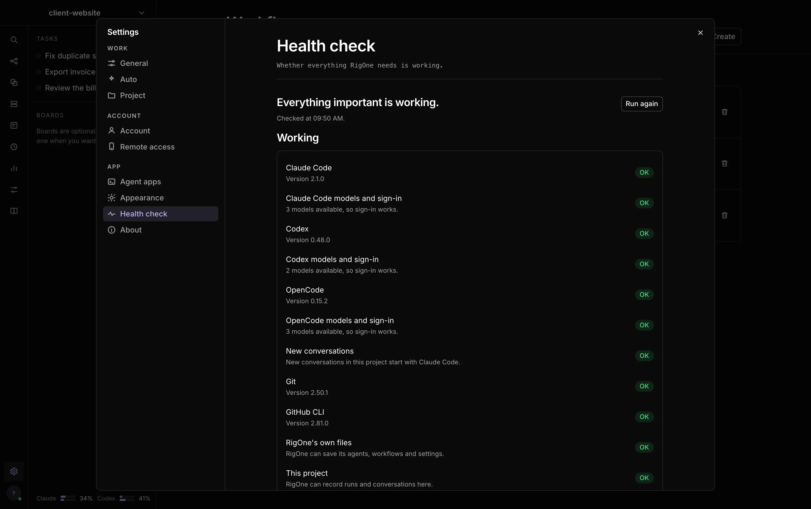

macOS asks for each permission the first time it is needed: access to the folders you work in
(including Desktop, Documents and Downloads), sending events to other applications, the microphone
or system audio if a workflow drives an app that records, and notifications, which RigOne uses when
a decision waits for you while it is in the background.

The interface follows the macOS language. RigOne speaks English, Polish, German, Spanish, French,
Italian, Portuguese, Chinese and Japanese; choose another in **Settings → Appearance**. What agents
and the engine write in a run stays in English, and this guide uses the English names of buttons
and screens.

## Tutorial: your first run, step by step

This tutorial takes you from an empty RigOne to a finished run and a goal handed to Auto. It uses a
small web project as the example; any folder with code works. Plan on about fifteen minutes, most of
it spent watching the agents work. The screenshots show the shipped app with demo data.

### Step 1: open a project and check your agent apps

Open the project menu at the top of the side panel and choose **Add a workspace** (with no project
yet, the menu button itself reads **Add a workspace**). Give it a **Name**, press **Choose folder**,
pick your project and press **Save**. RigOne opens a new task that asks **What should I do?** —
"Describe what you want to do, then choose how to work below."

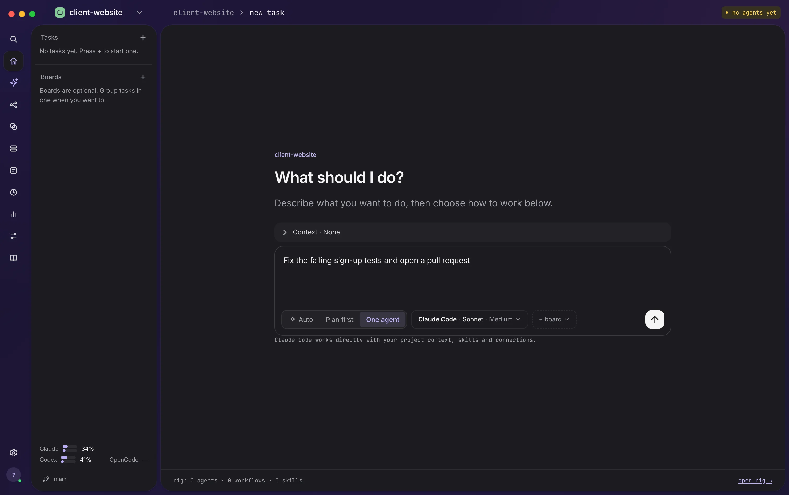

Before you build anything, open **Settings → Health check** and check that at least one agent app
says **OK**. If one is missing, install it or sign in — run `claude`, `codex` or `opencode` once in
Terminal — and press **Run again**.

You do not need an agent to start talking: in **One agent** mode the box answers in the project
folder with the agent app shown beside it. Only `/run` or a goal in Auto starts real work.

### Step 2: make an agent with one job

Open **Agents** (⌘1) and press **＋ Create** (once you have agents, the button reads **Create
agent**). The form has tabs:

- **Role** — a **Name**, a one-line **What it does**, and **Instructions** in your own words.
- **Model** — what it **Runs with**: Claude Code, Codex or OpenCode, with the model and effort the
  app offers, and **Give up after**, a timeout stopped the same supervised way as **Stop**.
- **Access** — **Can it change files**: keep **Look only** for agents that read, research or
  review; only the agent that writes the change needs more. **Can it reach the web**: reading and
  searching only; it never widens what the agent may do with your files.
- **Skills and connections** and **Advanced** — what the agent may use beyond its instructions.

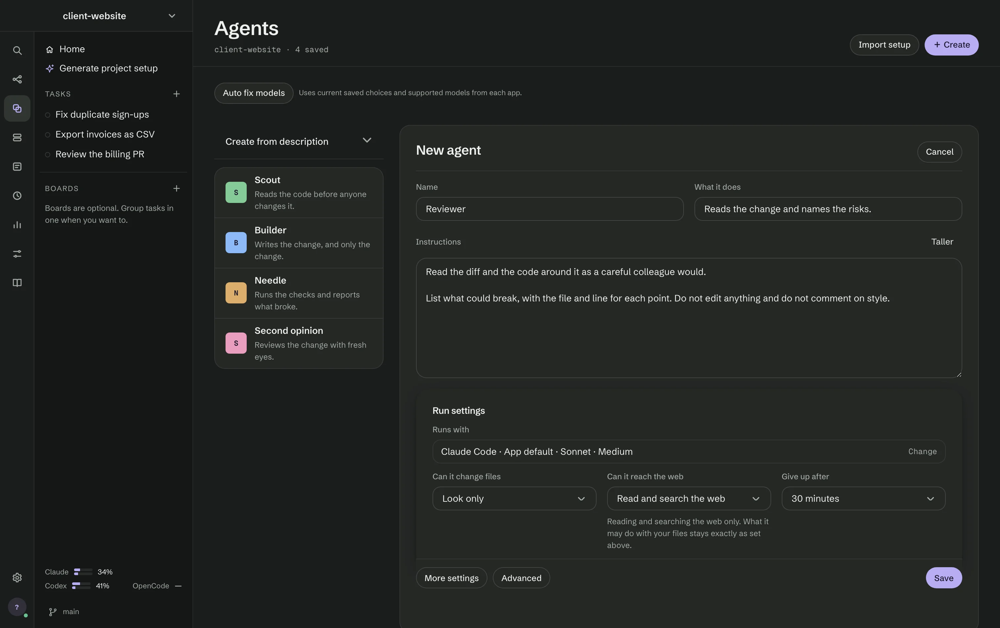

Press **Save**. For a first workflow, make three agents: one that reads and finds the cause, one
that writes the change, and a reviewer. **Create from description** drafts an agent from a sentence
when you would rather edit than write.

### Step 3: put agents in a row

Open **Workflows** (⌘2) and press **＋ Create** (or **Create workflow** once you have some). Use
the **+** button (**Add**) on the canvas to place a step for each agent and draw arrows between
them. An arrow means "runs after", nothing else. Two steps that come after the
same step start together, so a test check and a second opinion can run side by side once the fix is
written.

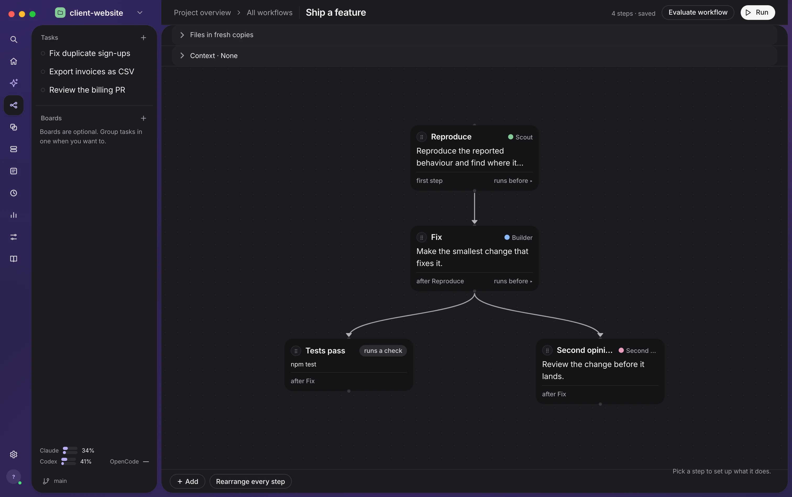

Add **A step that runs a check** after the step that changes code, with the command that proves the
work, such as `npm test`. RigOne runs it itself and records what it found; the agent does not get
to say it passed. Give the reviewing step an agent from another vendor, so the second opinion comes
from a different model.

### Step 4: read the plan, then start

Open a task in **Tasks** (⌘3) and press **Show workflow** in its header, or type `/run` and the
workflow's name. RigOne picks a workflow for you; choose another from the menu next to its name.
Under **Plan** on the right you see its state, the workspace and the number of steps, and every
step with the one it waits for. The play button beside a workflow in **Workflows** starts it at
once.

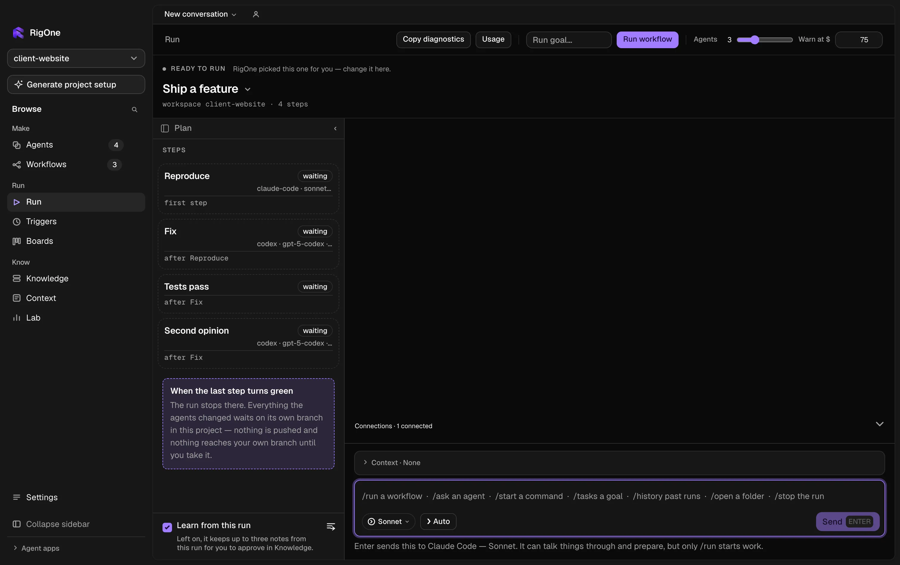

Open **Run options** (⋯) in the header. There, **Agents** sets how many steps may work at the
same time, and **What should this run build?** takes an optional goal. Leave **Learn from this
run**, at the bottom of the plan, ticked to get up to three suggested notes afterwards. Press **Run
workflow**. Before the first step starts, RigOne checks the whole graph and names any step
whose model, effort or permissions will not work.

### Step 5: watch, and answer when asked

The stream in the middle carries what every agent said, in order, with the files it read and
edited and the commands it ran. The plan on the right shows each step's state.

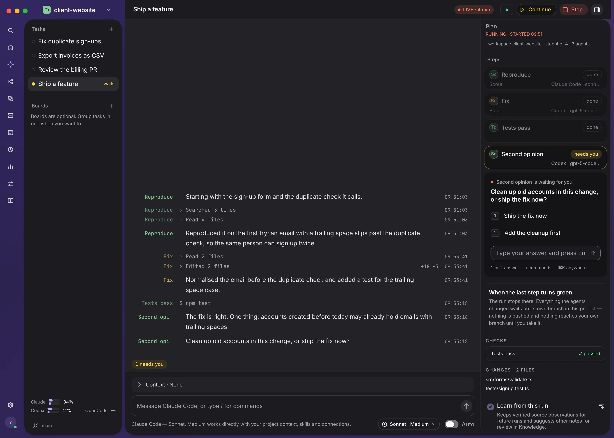

When an agent asks something, the question is pinned at its step in the plan — or under the stream
when the plan is hidden — with numbered answers, and the task's dot in the side panel turns to
waiting (point at it to read **Needs you**). Everything that does not depend on the answer keeps going.
You can keep writing to the Lead in the command bar; a message sent while it works joins its current
turn. **Stop** ends every running agent and records the proof that the processes are gone.

### Step 6: take the result

Each step ends **done**, **failed**, **stopped** or **not run**, and the run keeps apart what the
agents said, what the checks found and what you approved. The plan lists the files that changed.
Everything the agents changed waits on its own branch in your project: a workflow pushes nothing,
and nothing reaches your own branch until you take it. Review that branch with Git as you would a
colleague's, then merge it or delete it.

If you left **Learn from this run** on, open **Knowledge** and press **Keep** on the notes worth
keeping. An approved note goes into every future prompt in this project.

### Step 7: hand a whole goal to Auto

Once a workflow has run, try Auto. Press **＋** next to **Tasks** in the side panel (⌘N), choose
**Auto**, write the goal in a sentence and press **Run**. The line under the box says what Auto will
do; its **rules** link opens **Settings → Auto**.

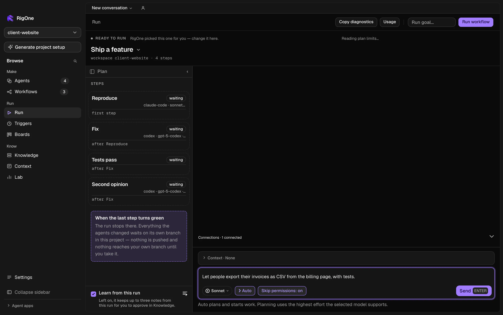

The Lead picks the agents it needs, builds ordinary workflows for the parts of the goal, runs them
and reads the results until every part is verified by checks and review. Decisions that wait for
you collect in **Needs you**, and macOS tells you when one waits while RigOne is in the background.
The goal is saved, so **Resume a goal** picks it up later — in a task it is also in **Run
options**. Read [Auto](#auto) before you turn on
**Full access for agents (YOLO)** in a project you care about.

### Working efficiently

- **One job per agent.** Small agents are easier to reuse across workflows and easier to fix when a
  step goes wrong.
- **Only the writer writes.** Keep readers, researchers and reviewers on **Look only**; it also
  lets RigOne run them beside each other without overlapping writes.
- **Split independent work.** Steps that do not depend on each other go on separate branches of the
  graph, and **Agents** sets how many run at once.
- **Prove every change.** Put a check after each step that changes code. "Nothing ran" never counts
  as a pass.
- **Mix vendors.** A second opinion from Claude Code on a change Codex wrote, or the other way
  round, catches what one model misses.
- **Give context once.** Put specifications, screenshots and PDFs in a **Context** set and attach it
  to the steps that need it, instead of pasting them into instructions.
- **Break a big goal down first.** **Plan first** (or `/tasks`) turns a goal into a list you review
  before anything runs.
- **Let RigOne draft the rig.** **Generate project setup** (the sparkle button in the rail)
  proposes agents and workflows from your repository; nothing changes until you choose **Apply
  setup**.
- **Move with the keyboard.** ⌘K finds any place, workflow or agent; ⌘N starts a task; ⌘1 to ⌘9
  open the screens; ⌘⌥1 to ⌘⌥9 pick a project tab.

## Concepts

RigOne uses a small, fixed vocabulary. The same words appear on screen, in error messages and here.

| Word | Meaning |
| --- | --- |
| **Project** | A folder on your Mac, added as a workspace. Agents, workflows, knowledge and connections belong to a project. |
| **Agent app** | The program that does the work: Claude Code, Codex or OpenCode. |
| **Agent** | A role: one job, one instruction, an agent app, a model and permissions. |
| **Workflow** | A saved graph of steps you can run again. |
| **Step** | A tile in a workflow and a card in the plan. |
| **Runs after** | What an arrow means. Nothing else. |
| **Task** | One line of work in the side panel: a conversation, a run or an Auto goal. |
| **Run** | One execution of a workflow against a project. |
| **Workspace** | A project folder in the project menu; a step works in a private copy of it. |
| **Check** | A command RigOne runs itself to decide whether a step's work holds. |
| **Review** | A step in which another agent, often from another vendor, reads the work. Its settings decide whether a failed review stops the run. |
| **Note** | Something learned in a run, kept for future prompts once approved. |
| **Skill** | Instructions an agent uses when they fit the work, kept in a `SKILL.md` file. |
| **Context set** | Named material — text, images, PDFs — prepared for the steps that need it. |
| **Connection** | A tool server an agent may use, such as a browser, a design tool or an issue tracker. |
| **Lead** | The agent you talk to in the command bar. It can prepare; only `/run` starts work. |
| **Auto** | A mode in which the Lead plans, runs and verifies a whole goal across several workflows. |
| **Goal** | What you hand to Auto, in a sentence. It is saved, so you can resume it later. |
| **Needs you** | The one list of every decision that waits for you. |
| **Overview** | One page with everything a project has, in tabs: summary, score, repository, agents, workflows, knowledge and automation. |
| **Score** | How easily agents move through a project, out of 100, with what to fix first. |
| **Board** | A shared list of tasks with comments and members, encrypted on your Mac. |
| **Remote access** | Following and steering your work from a paired phone or tablet. |

## The window

The RigOne window has three columns: a narrow rail of icons on the far left, a side panel with your
tasks and boards, and the screen you opened. When two or more projects are open, project tabs run
along the top of **Tasks**.

In the default **Surface** theme the window is drawn as islands on glass: the rail and the title
bar sit on the glass, the side panel and the screen are rounded islands, and your macOS wallpaper
shows through around them.

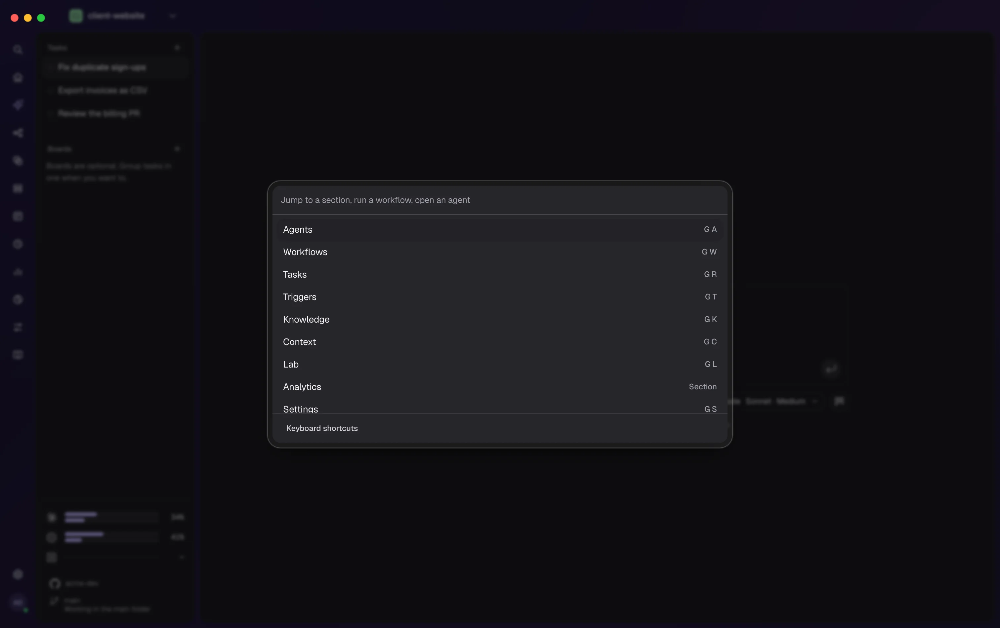

### The rail

The rail holds every place, top to bottom. Each icon names its place when you point at it.

| Icon | Place | Shortcut | What it is for |
| --- | --- | --- | --- |
| Magnifier | **Search** | ⌘K | Jump to any place, workflow or agent |
| House | **Home** | — | Back to a fresh new task |
| Sparkle | [Generate project setup](#generate-project-setup) | — | Drafts agents and workflows from your repository |
| Three joined dots | [Workflows](#workflows) | ⌘2, G W | Steps in a row, on a canvas |
| Two squares | [Agents](#agents) | ⌘1, G A | The roles that do the work |
| Two stacked bars | [Knowledge](#knowledge) | ⌘5, G K | Notes and skills that go into prompts |
| Page | [Context](#context) | ⌘6, G C | Material prepared for steps |
| Clock | [Triggers](#triggers) | ⌘4, G T | Runs that start on their own |
| Bar chart | [Lab](#lab) | ⌘7, G L | Test agents on your own cases |
| Sliders | [Overview](#overview) | G P | The whole project on one page |
| Book | [Skills](#skills) | — | The skills the project's files give its agents |
| Phone | [Remote access](#remote-access) | — | Shown only while Remote access is on |
| Gear | [Settings](#settings) | ⌘8, G S | What RigOne does by default |
| Initials | Account | — | Agent apps, plans, gateways, GitHub account |

[Tasks](#tasks) (⌘3, G R) and [Boards](#boards) (⌘9, G B) open from the side panel.

### The side panel

- **The project menu** at the top lists your workspaces. It also holds **Import setup from
  project** and **Add a workspace**.
- **Tasks** lists the tasks of this window, each with a coloured dot for its state; point at a task
  to read its state — **Working**, **Needs you**, **Done**, **Failed**, **Stopped** — and how long
  it has run. **＋** (⌘N) starts a new task. Double-click a task, press F2 or use **Rename** in its
  menu to rename it; **Close** closes it. Your tasks come back, in the same order and with the names
  you gave them, after you quit and reopen RigOne.
- **Boards** lists your boards with the number of tasks; **＋** creates one. Boards are optional.
- **Plan limits** at the bottom show, for each agent app that is on and signed in, a row with its
  logo and how much of the plan is used; point at a row for the 5-hour window and the week.
  OpenCode does not report plan limits.
- Below them, the panel says where RigOne works — **Working in the main folder** or in a copy —
  which opens **Project branches**, and which GitHub account this folder uses.

Drag the panel's edge to make it wider or narrower; a double-click resets it.

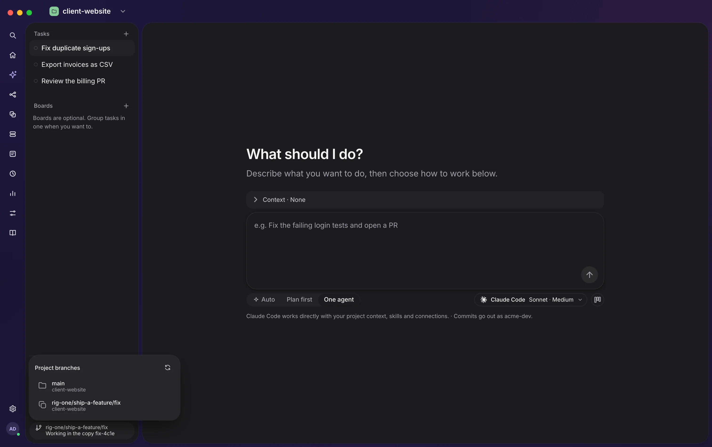

### The account menu

The initials at the bottom of the rail open **Account and agent apps**:

- **Agent apps** — Claude Code, Codex and OpenCode with their versions, or what is missing, with
  **Retry**.
- **Plans** — how much of each plan is used.
- **Model gateways** — the gateways you added in Settings.
- **Models on this Mac** — the local models Ollama offers, if it runs.
- **Connections** — the tool servers turned on in this project.
- **GitHub account for this folder** — which GitHub login commits and pull requests go out as.

## Projects side by side

Every project you open becomes a tab; once two or more are open, the tabs run along the top of
**Tasks**. A colour tile tells projects apart in the tabs and the project menu, and a dot says
whether the project is **working** or **waiting on you** (its tab then also reads **waits**); a
project with nothing running has no dot. **＋** (**Open a project**) lists the projects you closed
and **Add a project folder…**.

A plain tab holds one project. Projects shown together form one split tab, up to three side by
side:

- **Show another project beside this one (⌘⌥\\)** at the end of the tab strip splits the tab you
  are in. A tab's menu offers **Open side by side with** the project you are in.
- **Drag a tab** onto another tab to join them, onto the empty part of the strip to take it out of
  a split tab, or onto the edge of a tab to reorder.
- **Drop a tab onto a pane** to show that project there.
- **Separate the projects** — the × on a split tab, or its right-click menu — turns it back into
  plain tabs. Right-click your own tab for **Show another project beside this one** or **Close**.
- **Drag the edge** between two panes to resize them; a double-click shares the width evenly.

Click a pane to work in it. ⌘⌥W closes the pane you are in; the project stays open as a tab. The
× on a plain tab closes that project. Every project
keeps its own tasks, runs and questions, so a run keeps going in one pane while you start a task in
another. Your tabs and panes come back after you quit and reopen RigOne.

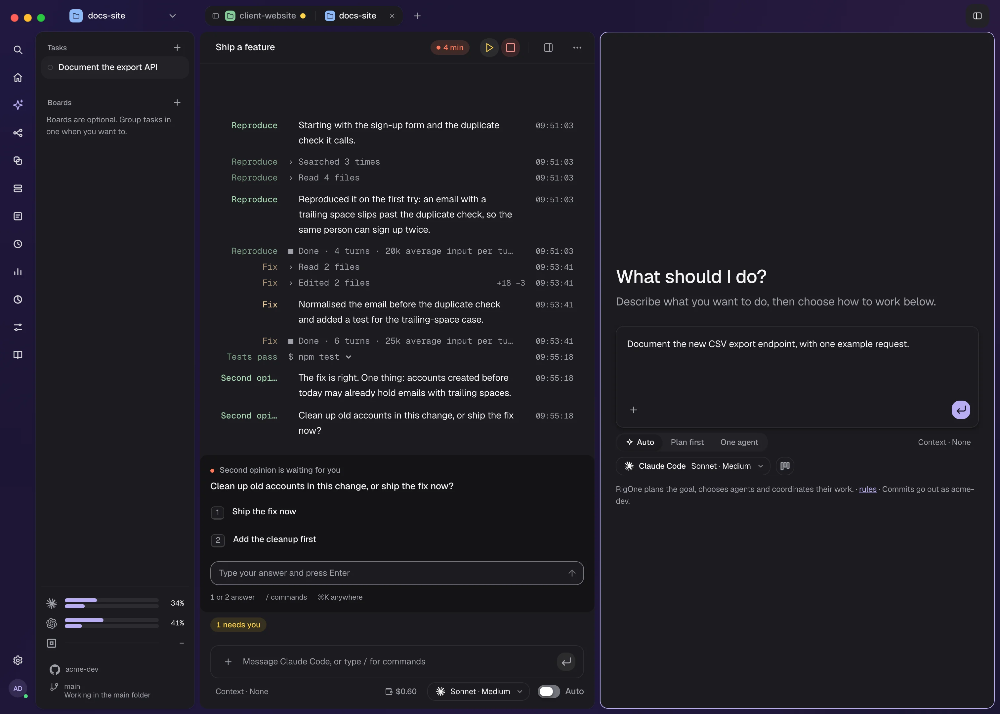

## Search and keyboard shortcuts

**Search** (⌘K) opens **Go to anything**: type part of a name to jump to a section, start a new
Claude Code, Codex or OpenCode conversation, **Break a goal into tasks**, run a saved workflow or
open an agent. **Copy diagnostics** and **Usage** open **Settings → About**. Press **Keyboard
shortcuts** for the full list, or **?** anywhere outside a text field.

| Keys | Does |
| --- | --- |
| ⌘K | Open Go to anything |
| ⌘N | Start a new task |
| ⌘1 … ⌘9 | Agents, Workflows, Tasks, Triggers, Knowledge, Context, Lab, Settings, Boards |
| G, then a letter | Go to a place: A, W, R (Tasks), T, K, C, L, S, B, P (Overview) |
| ⌘⌥\\ | Show another project beside this one |
| ⌘⌥← / ⌘⌥→ | Move to the pane on the left or right |
| ⌘⌥1 … ⌘⌥9 | Pick a project tab |
| ⌘⌥W | Close the pane you are in |
| ? | Show the shortcuts (outside a text field) |
| Esc | Close |

## Tasks

**Tasks** is where you give work to agents and watch it happen: talk to the Lead, run a saved
workflow, hand a goal to Auto and answer what agents ask.

### A new task

A new task asks **What should I do?** Write the goal and choose how it runs:

- **Auto** — RigOne picks the agents and runs the goal until it is verified. See [Auto](#auto).
- **Plan first** — RigOne writes the task list first; nothing runs until you start it.
- **One agent** — one agent works on it in this folder. Type `/` for commands.

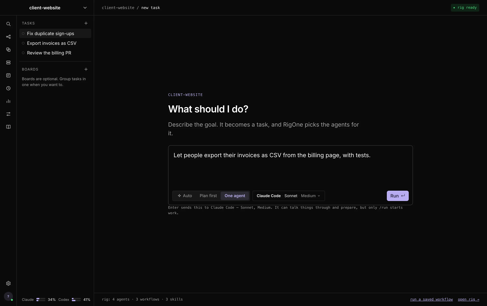

On the right of the row under the field, the pill shows the agent app, model and effort; open it
to switch between Claude Code, Codex and OpenCode, or tick **Default for this project**. The board
icon (**Board (optional)**) files the task on a board. **Context** on the left attaches a context
set. **Run** (Enter) starts it; Shift+Enter adds a line.

Type **@** to point at a place in the project, and drag images, files or folders onto the field —
**Drop to add to your message** — to send them with the goal. Saved Auto goals and board tasks
appear under **Pick up where things are**; with more than three saved goals, **Resume a goal**
lists them.

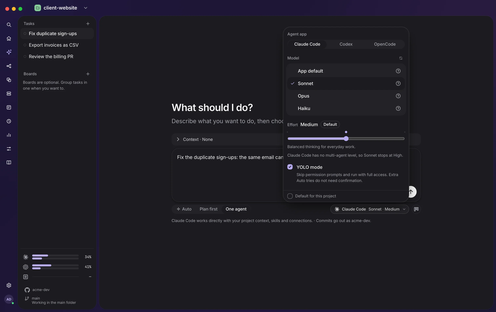

### Run a saved workflow

**Show workflow** in a task's header opens the workflow view. The header names the workflow —
RigOne picks one; choose another from the menu next to its name — and **Plan** on the right shows
its state: **Ready to run**, **Running**, **Finished**, **Failed**, **Stopped** or **Interrupted**.
While nothing runs, the controls wait in **Run options** (⋯) in the header:

- **Connections** — how many tool servers are connected for this task.
- **Agents** — how many steps may work at the same time (**How many agents at once?**), with **What
  should this run build?** for an optional goal. The limit is real: independent branches do run in
  parallel up to it. More agents finish sooner but use more memory.
- **Run workflow** — starts a new run of the whole workflow from the beginning.
- **Show conversation** — when two or more agents speak, all of them or one.

While the run works, **Stop** and a **LIVE** timer stay in the header, with **Hide plan** to fold
the plan.

Before any step starts, RigOne checks the whole graph: required inputs, permissions, and every
step's model and effort against what your agent app reports. An unsupported choice stops the run
before earlier agents spend time, and names the step that needs attention. These checks cannot
promise that the network or your quota stays available for the whole run.

A spending warning is optional and off by default. Turn on **Warn about spending** in **Settings →
Runs** to be told when a run reaches an amount; RigOne warns, it does not stop the run, and it
cannot count a model whose price it does not know.

### Watching a run

The stream in the middle carries what every agent said, in order, with the files it read and
edited, the commands it ran and what they returned. **Show earlier activity** brings back older
lines and **Jump to newest** returns to the end. **Settings → Appearance → Conversation view**
draws the stream as a **Terminal** log (the default) or as **Agent chat** bubbles.

The plan on the right reads top to bottom. Each step card names the step it waits for, its agent
app and model, and its state; a step that waits for something says what — a free place, the
heavy-work slot, a Rust build, a usage limit or earlier steps — with numbers and since when.
**Checks** and **Changes · N files** follow the steps. Click a step card to open that step's own
conversation. Drag the plan's edge to make it wider, and use **Queue runs** at its bottom to line up
the next ones.

When an agent asks something, the question is pinned at its step in the plan with numbered answers
and a field for your own words. The copy pinned under the stream, and the one in Needs you, also
have **Dismiss**, which closes it without answering; the Lead hears that you did.
Everything that does not depend on the answer keeps going. The badge **1 needs you** under the
stream opens [Needs you](#needs-you).

Outcomes say what really happened: **done**, **failed**, **stopped** or **not run**. An agent
saying "Done" never hides a later failure. Repeated runs of the same step share one card with a
count. A long conversation keeps its newest lines on screen and brings earlier ones back as you
scroll up.

Some work waits its turn on its own, whatever the limit: only one Rust build runs at a time on your
Mac, whichever step or shell started it, while tests, running apps and reviews carry on beside it.
When a provider is at capacity or a usage limit is reached, the step waits, says when it tries
again, and continues the same conversation.

### The command bar

The field at the bottom talks to the Lead. Under it, **Context** on the left attaches a context set
to the conversation and opens upward (**Context · None** or **Context · 2 selected**). On the
right, the pill chooses the agent app, model and effort for this conversation, and **YOLO mode** in
it — "Skip permission prompts and run with full access" — is set before the conversation starts.
The **Auto** switch turns Auto on for the task. The Lead can talk things through and prepare, but
only `/run` starts work.

| Command | Does |
| --- | --- |
| `/run` | Start a workflow. Add what to build after its name. |
| `/ask` | Start one agent. Add what it should do after its name. |
| `/start` | Start a command and keep it running. It shows up in the agents list. |
| `/tasks` | Break the goal into tasks you can review — nothing runs until you press Run. |
| `/history` | Show what has run in this folder. Add a word to narrow the list. |
| `/open` | Choose a folder to work in. |
| `/stop` | Stop the run that is going. |

A message you send while the Lead is working joins its current turn, and the Lead answers it before
it carries on. If the Lead is inside a long command, the bar says your message lands when that
command ends. Type `/` and a skill's name to use a skill, **@** to name a place in the project,
and ↑ / ↓ to bring back earlier lines.

### Stopping a run

**Stop** ends the whole process group of every running agent, then verifies that the processes
are gone and records the proof with the run. **Interrupt** stops only what the Lead is doing now
and lets it answer you.

## Auto

Auto hands a whole goal to the Lead. Start a task in **Auto** mode, or turn on the **Auto** switch in the
command bar, and write what you want in a sentence. The Lead picks the roles and skills it needs,
builds ordinary workflows for the parts of the goal, runs them, reads the results and chooses the
next part, until every part is verified. You can keep talking to it while it works.

- **RigOne decides when work is verified, not the Lead.** A part counts as done only when its
  checks and review prove it. A review that fails reopens exactly the result it judged. Work the
  Lead does itself shows as "Lead says done · not verified" until an independent review and the
  checks pass.
- **Results arrive as in any run.** Auto's workflows work in their own copies, and the result is
  committed with a conventional message. Pushes and pull requests are checked against the GitHub
  account chosen for the project and show "Pushed as …". An Auto step uses that account only when
  its agent's **Access** tab has **Allow GitHub writes in Auto** on.
- **The plan shows the parts.** With Auto on, the plan column is **Agents & work**. It groups each
  part of the goal under **Needs attention**, **In progress**, **Up next** and **Finished**, with
  its state, such as **Waiting to start**, **Workflow running**, **Ready to verify**, **Completed**
  or **Needs repair**. Open a part for its **Scope**, the **Full report**, **Technical details**
  such as where its code was saved, what it is doing now and roughly how long is left. **Open
  workflow** shows each step's agent, model, access and result, and **Show evidence** reveals the
  files that prove it in Finder. The header counts how many parts are verified.
- **Each requirement names its proof.** An acceptance criterion names the tests that prove it; the
  check before the review runs them, and the reviewer sees the result next to the criterion.
- **Saved goals.** A goal is saved where it reached. A stopped goal says "Goal saved. Resume it or
  send a message to continue.", with **Resume goal** to carry on and **Start a new goal** to leave
  it saved. **Resume a goal (N)** lists the saved ones. Each task runs its own goal; up to three
  goals work in one folder at a time, and more wait their turn.
- **After a restart.** If RigOne closes while a goal runs, the goal carries on the next time RigOne
  opens; goals you paused stay paused. A retry after an interrupted attempt starts from that
  attempt's saved work. Turn this off with **Resume goals after RigOne restarts** in **Settings →
  Auto**. Quitting while steps run asks first — **Quit RigOne?**, with **Keep running** and
  **Quit** — and then stops every agent before RigOne closes.
- **Waiting for something.** The Lead can set a condition to wait for: a command RigOne runs on an
  interval until it succeeds or a deadline passes. The stream says what it waits for and until
  when. When the condition is met, the Lead continues the goal, also after RigOne restarts. If time
  runs out, RigOne asks you what the Lead should do now.
- **When the Lead stops early.** A Lead that stops while its goal still has work and nothing is
  running starts again on its own, spaced out and at most three times without progress.


### Taking over, pausing and stopping

- **Take over** stops the Lead's current reply. The goal keeps going, and the Lead comes back when
  there is work for it.
- **Stop ▾ → Pause Auto** starts no new work until you press **Resume**, which takes the place of
  Take over; running workflows finish.
- **Stop ▾ → Stop Auto** (**Stop Auto and its 2 workflows** while workflows run) asks first. The
  goal is saved where it reached.

### Full access

**Full access for agents (YOLO)** in **Settings → Auto** is on by default. With it on, agents skip
their own permission prompts, like an agent you run yourself in YOLO mode. With it off, each agent
app uses its own safer permission mode and still works without asking. Either way every step works
in its own copy, with your sign-ins, and the project's `deny` rules, the GitHub account check and
keeping secrets out of command lines stay in force. Each step's screen says whether it ran with full
access.

For a conversation outside Auto, **YOLO mode** in the agent app, model and effort pill makes the
same choice — "Skip permission prompts and run with full access". With it on, extra Auto tries do
not need your confirmation. It is set when the conversation starts; start a new conversation to
change it.

In Auto the Lead can give a step any Connection you have turned on. A Connection you turned off
stays off.

### Needs you

Every decision that waits for you sits in one list, **Needs you**. Each card says what it is about
and what happens after each answer; answers are numbered, some cards take your own words, and a
question can be dismissed, which the Lead hears. Several cards of the same kind can be answered at
once, with "… · all 3". A decision is repeated once an hour, at most three
times. When RigOne is not in front, macOS tells you a decision is waiting, or that a goal finished
or stopped, and the Dock icon shows how many decisions wait.

| Card | Asks |
| --- | --- |
| **Question** | What the Lead or a planner wants to know |
| **Approval** | Let a part write outside its copy, or allow an outward action? |
| **Exclusion** | Leave a part out of this goal? |
| **Retry** | Allow one more try? |
| **Checkpoint** | A step in the workflow that asks you |
| **Design review** | Accept the look of a changed screen, or mark changes |
| **Failing tests** | A check failed on tests this goal did not change: fix them here, move to the latest main, or pause |
| **Usage limit** | Wait for the reset, or use another agent app? |
| **Changed definitions** | Admit agents or workflows that changed while the goal ran? |
| **Same requirement failed** | Three tries in a row failed on one requirement: accept with a recorded gap, try once more, carry it to the next stage, or exclude the part |
| **Recorded gap** | Accept a part with a gap that stays in the goal summary? |
| **Confirmation** | Anything else the Lead needs you to confirm |

**Design review.** When an Auto result changes screens, RigOne shows you the tester's screenshots
before the result is recorded. Press **I accept**, or **Mark changes**: click a spot on a
screenshot, write what should change and **Send remarks**. The Lead turns each remark into the next
repair. A change to interface files that only touches logic skips the review, once an independent
check of the whole change confirms that nothing visible changed; if that cannot be shown, the
review is asked for as usual. Turn the review off with **Review the design before interface changes
are recorded** in **Settings → Auto**.

## Boards

**Boards** (⌘9) holds shared boards of tasks, with comments and members. It works without choosing
a folder, and together with Remote access it is the only part of RigOne that needs an account:
sign in to your MonoOne account in Boards or **Settings → Account**. An IndexOne account signs in
with the same email and password. **Explore a preview** opens a demo board without an account.

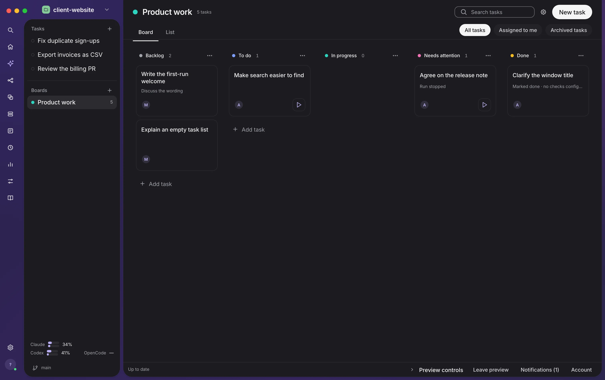

- **Encrypted on your Mac.** Tasks, comments and activity are encrypted and signed before they
  leave your Mac; the server only relays ciphertext. Board keys are kept in the macOS Keychain.
- **Members and devices.** Invite people by email as **Editor** (changes tasks and posts) or
  **Viewer** (reads). Before a new member or device receives a board key, both sides compare the
  same fingerprint.
- **Offline.** Changes made without a connection wait on this computer and are sent when it returns.

### Board and List

A board has two views. **Board** shows columns — by default Backlog, To do, In progress, Needs
attention and Done — and cards you drag between them. **List** shows the same tasks as a table with
assignees, due date, priority and the latest run. **All tasks**, **Assigned to me** and **Archived
tasks** filter both. Each task gets a short number such as `PRO-12`. In a board's settings,
**Columns and sprints** chooses Kanban columns or **Sprints**, and can archive finished tasks after
a number of days.

### A task

A task opens in a window with three tabs. **Details** shows its properties — status, assignees,
due date, priority, tags, what it depends on, the repository, workflow and model (and its sprint on
a sprint board) — its description, **What will show it worked**, and subtasks. **Activity** keeps
the comments and a **Task history** of who created it, checked subtasks and started runs. **Runs**
keeps what ran.

### Run a task from its board

**Run with Auto** on a card, or the **Runs** tab of a task — **Run with** a workflow or Auto, a
**Folder on this computer**, then **Start** — starts it as a saved workflow or as an Auto goal in a
folder on this Mac. One computer claims the task; a second start
elsewhere is refused with the name of the device that runs it. Progress and the final status appear
on the board for every member. A question from the agent appears in the task: a member who can edit
the board answers it there, and RigOne passes the answer to the run exactly once. While an Auto runs
on your Mac, a comment can go **To Auto (steer the work)** instead of **To the team**.

## Triggers

**Triggers** (⌘4) start a workflow without you pressing Run. Today the supported source is
**Linear**: an issue newly assigned to you starts one run.

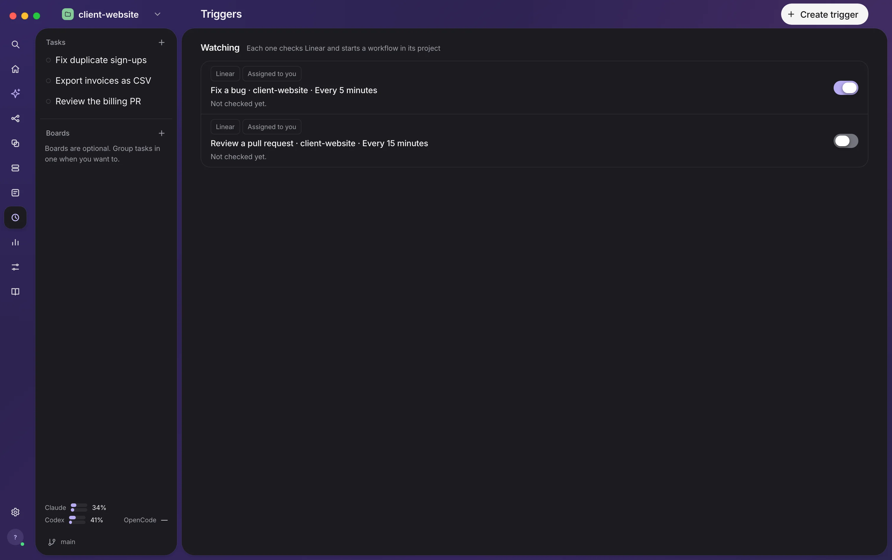

Press **Create trigger**. The form opens on its own page, **Triggers › New Linear trigger**:

- **Connector** — Linear, and **When** — "An issue is assigned to you".
- **Environment variable name** — the variable that holds your Linear key; put the key there before
  testing or saving. **Test connection** checks it without starting anything.
- **Workspace** — runs from this trigger always use this workspace, even while another one is open.
- **Check every** — every minute, every 5 or 15 minutes, or every hour.
- **Workflow** — what runs.

Each trigger in **Watching** shows **Linear** and **Assigned to you**, its workflow, workspace and
how often it checks, what it last did, and a switch to turn it on or off. **Run again** or **Retry**
shows when a start can be repeated. Click a trigger to edit it.

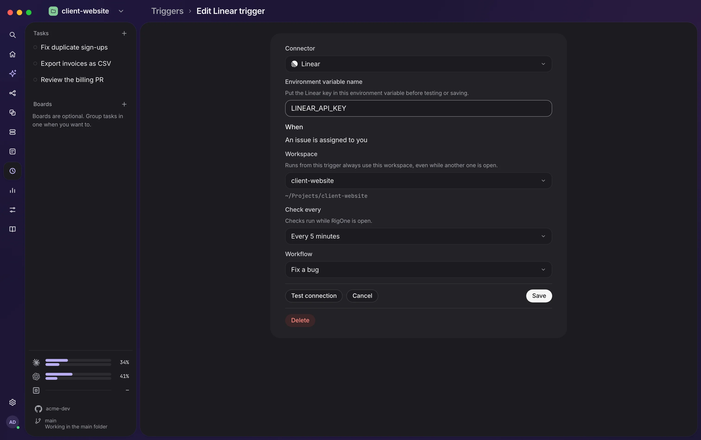

- The first check only arms the trigger; issues already in your backlog do not start runs.
- One issue starts one run, even across a restart. Editing an issue does not start a second one.
- To delete a trigger, open it and press **Delete**; it warns that a saved issue waiting to start
  is discarded, then **Delete trigger** or **Keep it**.

Triggers run while RigOne is open; there is no background daemon.

## Reviewing a step

Click a step in the plan to open it. Its screen shows what it was given, what it produced and what
it said, with what it cost (**Cost $0.42**) at the right of its header and **Run this step
again**. Under **Changed
lines** the step reads like a review in an IDE:

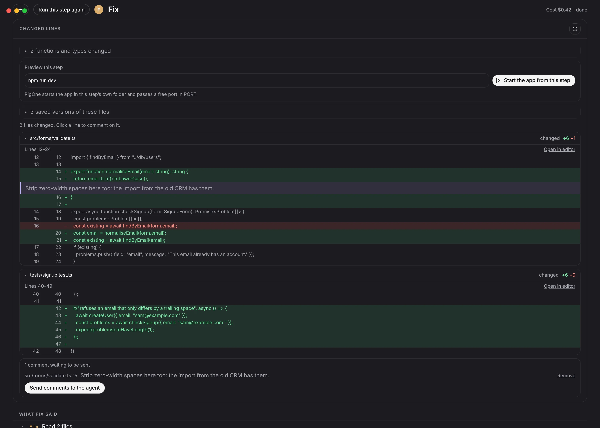

- **Files, hunks and lines.** Each changed file says whether it is new, changed, deleted, renamed
  or binary, with its added and removed lines. **Open in editor** opens the file at that line in
  your editor.
- **Comments on a line.** Click a line, write a comment and choose **Add comment**. **Send comments
  to the agent** sends them as one message that names every file and line. A step that is still
  working reads it after its current turn; a finished step carries on in its own folder (a
  finished **Look only** step cannot change files, so it cannot carry on).
- **2 functions and types changed** lists each one with the places that use it — "used in 2
  places" or "not used anywhere else".
- **Preview this step.** Type your command — such as `npm run dev -- --port $PORT` — and press
  **Start the app from this step**. It runs in the step's own folder with a free port in `PORT`.
  **Open preview** shows the app in a window of its own; **Open in browser** and **Stop** do what
  they say.
- **3 saved versions of these files.** RigOne keeps a version after each turn. **Go back to this
  version** restores one; the newest says **This is what is there now**, and what is there now is
  kept as a new version, so you can always return.

When the work of the steps is brought together and two of them wrote the same files differently,
nothing is combined: RigOne says which step disagrees and on which files. In a task list, the task
that clashes is left out — "it clashes with … on …" — and its card offers **Run … again on top of
the result** or **Leave … out**.

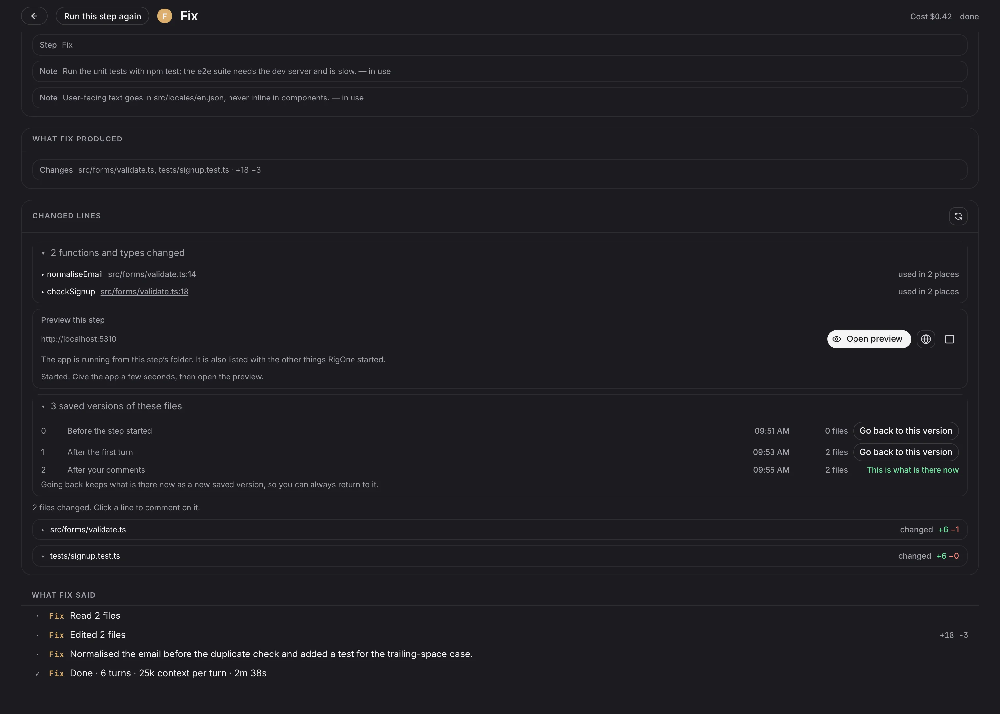

## Checks and reviews

When a step finishes, RigOne runs the checks itself; it does not ask the agent whether it worked.
At the end you see three things that are never confused with each other:

1. **what the agent said** it did,
2. **what the checks actually found**,
3. **what you approved**.

"Nothing ran" is its own outcome and never counts as a pass: a green exit code without proof that
tests ran is not accepted as a green check. Vitest results count individual tests, not test files,
and a check shows live diagnostics while it runs. When required test evidence is missing, the work
a step completed is kept. A check whose program could not be found says so
instead of reporting a code failure, and a red check says first which tests failed or what stopped
it.

Checks are fair about failures the change did not cause:

- **Old failures.** When a check is red, RigOne runs it again on the code without the change, with
  the same dependencies, to tell old failures from new ones.
- **Flaky tests.** A check whose only failures are unstable tests outside the change passes with a
  warning that names them. A failure inside the change, or one that is also red without it, still
  fails.
- **No repeated work.** A check that passed is reused, also by another workflow, when it proved the
  same thing on the same code. A check split into parts re-runs only the parts whose inputs
  changed, and the parts that failed last time first.
- **Impossible plans.** The Lead's plan is refused before the run when a check could never confirm
  the tests it must confirm.

A **review** is a step where another agent — often from another vendor — reads the work. In a
workflow, the step's **If this step does not pass** setting decides whether a failed review stops
the run, carries on or asks you. In Auto, a failed review sends the work back for repair.

## Where the changes go

Each step works in its own copy of your code, so agents cannot trip over each other. When the run
ends, the work of the steps is combined on one new branch in your project — "The work of 3 steps is
on … Merge it when you are ready." **A workflow pushes nothing, and nothing reaches your own branch
until you take it;** only Auto pushes and opens a pull request, and only when you allow it. If two
steps changed the same file differently, the step after them is not started, both copies are kept,
and the message names the step and the files. Files ignored by the project, such as build caches,
are skipped. Step folders are removed once their work is committed, and copies of runs that ended
more than three days ago are removed when the disk runs low (see [Storage](#storage)).

## Safety model

RigOne treats orchestration failures as product failures, not terminal noise:

- two steps that changed one file differently stop the step after them, and both copies are kept;
- cancellation ends the whole process group and verifies that it is dead;
- timeouts go through the same supervised shutdown path;
- prompts and secrets go through stdin, never command-line arguments;
- child environments are rebuilt from an explicit allowlist — unless full access (YOLO) gives the
  agent your environment;
- unknown vendor events are recorded and ignored instead of crashing the run;
- a green exit code without proof that tests ran is not accepted as a green check;
- files are the source of truth, while the SQLite index can be deleted and rebuilt.

Settings passed through to an agent app can never raise an agent's file permissions; the **Can it
change files** control is the only way to do that. A project setting can never send an agent's
traffic to another address; model gateways are set in your own settings.

With **Full access for agents (YOLO)** on, Auto's agents skip their own permission prompts, as
when you run them in YOLO mode in a terminal; each step still works in its own copy. Turn it off to
let each agent app use its own safer permission mode.

### What leaves your Mac

RigOne runs on your Mac and works in your folders. The agents it starts are Claude Code, Codex or
OpenCode, so what they read goes to their providers exactly as when you run them in a terminal, and
their commands may reach the network. A model gateway receives the traffic of the agents you send
through it. A trigger talks to Linear with the key you gave it. Boards talks to the MonoOne server,
which only ever receives encrypted tasks, comments and activity. Remote access connects your paired
devices to your Mac through the MonoOne relay.

## Agents

An agent is a role you define once and reuse in any workflow. **Agents** (⌘1) lists every agent
with its file access, model and effort; **Import setup** and **Create agent** sit in the header.
Click an agent to read it: its instructions, model, access, skills and connections, and how many
workflows use it, with **All agents** to go back. It stays read-only until you press **Edit**,
which opens the form with the tabs **Role**, **Model**, **Access**, **Skills and connections** and
**Advanced**, and **Cancel** or **Save**.

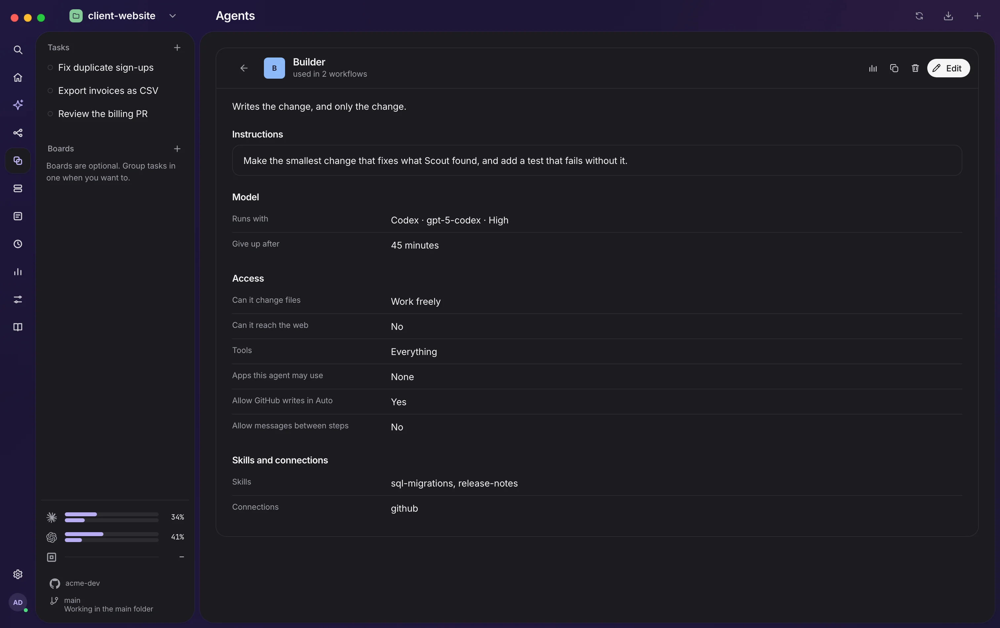

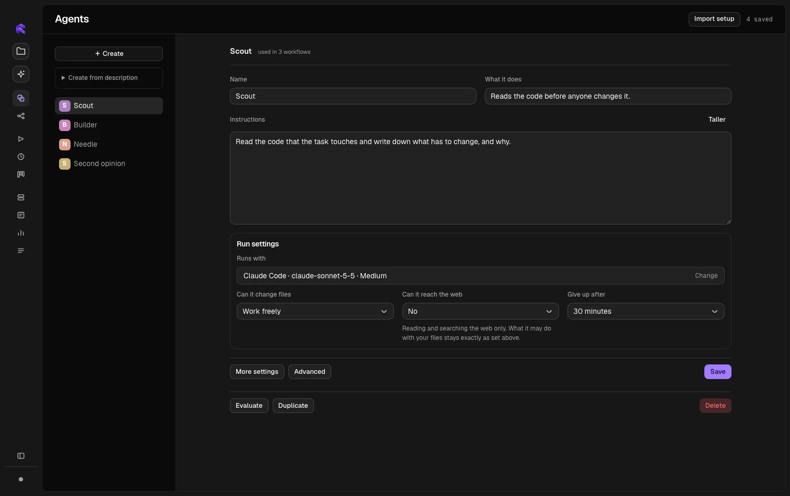

### What an agent holds

- **Name** and **What it does** — a one-line description shown wherever the agent is used.
- **Instructions** — the agent's own words: what to do and how. The field grows as you write.
- **Runs with** — the agent app (Claude Code, Codex or OpenCode), the model and the effort. The
  models and effort levels offered are the ones your app reports; **Refresh models** updates the
  list, and your choice is never replaced for you. For OpenCode, choose a model it offers or type
  the service and the model, such as `zai/glm-4.6`.
- **Model source** — **App default**, or for a Codex agent **Ollama on this Mac**, with where it
  runs and how much it reads at once.
- **Model gateway** — **Straight to the agent app**, or a gateway you added in **Settings → Agent
  apps**; then type the **Model name** exactly as the gateway spells it.
- **Can it change files** — **Look only**, **Ask first** or **Work freely**.
- **Can it reach the web** — **No** or **Read and search the web**. What it may do with your files
  stays as set above.
- **Give up after** — 10 minutes, 30 minutes or no limit. A timeout ends the agent the same
  supervised way as **Stop**.

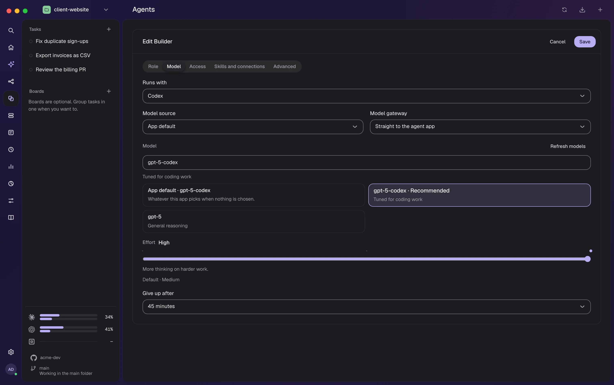

The **Access** tab also holds the tools it may use (Claude Code only), **Apps this agent may use**,
**Allow GitHub writes in Auto** and **Allow messages between steps**. **Skills and connections**
chooses its skills and connections; a name this project does not know stays visible and marked, so
you can remove it before a run refuses to start. **Advanced** passes extra options to the agent
app, one pair per line.

**Evaluate** tries the agent in the [Lab](#lab) and **Duplicate** copies it. **Delete** asks first
in a small dialog that says how many workflows use it — their steps will have nothing to run — and
that this cannot be undone.

### Create from description

**Create from description**, above the list, drafts an agent from a sentence with **Create with
Codex** or **Create with Claude**. The draft says what was checked and what was not, what it had to
guess from your description and why it chose its settings, so you can edit before you save.

### Bringing a setup from another project

Each project starts with an empty library. **Import setup** on the Agents screen reads a project's
own agent-app files — `.claude/`, `.codex/`, `.agents/` and open-standard files — and turns its
agents, skills, connections, workflows and notes into RigOne files. Scanning reads files only; it
does not run hooks, skills, agents or connections.

To copy what you built in another RigOne project, open the project menu and choose **Import setup
from project**. Pick a source, filter by category and tick items. Copies stay independent; the
import never overwrites existing files and never copies secrets or history.

Connections found in your personal agent-app settings arrive turned on. Connections found in a
project's files start turned off and wait for you, because a repository's settings can name any
command to run. A skill that asks for tools of its own waits until you have read it.

## Workflows

A workflow is the thing you build on the canvas and run again. **Workflows** (⌘2) lists the saved
ones: each with its description, steps and agents, how often it was used and how its last run
ended. The first one shows its chain of steps and a filled play button.

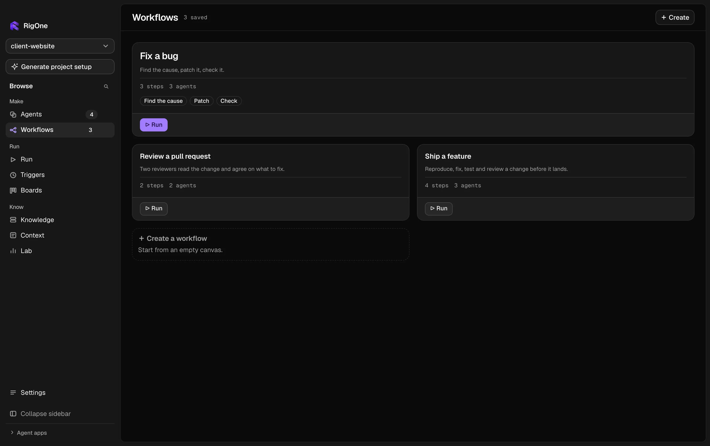

Press **Create workflow** (**＋ Create** while there are none) for an empty canvas, or open a
workflow to change it. The play button starts it right away in Tasks; duplicate and delete sit
beside it, and delete asks first — the file goes away, runs you already did stay. Row actions here
and elsewhere are icon buttons that name themselves when you point at them. In the library of a
workspace with several projects, a workflow Auto will not use as a template says why, by step name,
with a button that fixes it where that is possible.

### The canvas

Steps are tiles joined by arrows. Each tile says what runs it — such as "Claude Code · Sonnet ·
Medium" — and which step it comes after, or how many handoffs it reads. During a run, a tile also
shows how long its conversation has grown. The dock under the canvas holds **Add**, **Rearrange
every step**, **Zoom out**, **Zoom in** and **Fit to screen**. **Add** offers, grouped by getting
work done, checking the work and what to do when a check says no:

- **A step an agent does** — an agent does a piece of the work.
- **A step that leaves a command running** — starts an app or a server and waits until it answers,
  so later steps can test it.
- **A step that runs a check** — RigOne runs a command and records what it found.
- **A step that asks you** — the run stops and waits for your answer.
- **A way back, to try again** — a loop from a check back to the step that fixes, with a limit.

The header reads **All workflows** and the workflow's name, then how many steps it has and whether
it is saved, a badge with the number of things to fix — each with a button that fixes it, or **Fix
all** — then **Workflow settings**, **Evaluate workflow** and **Run**, which stays off while a
problem exists.

A step can run several copies of itself when you want more than one take. A step with several
arrows coming in reads every handoff it receives, so "combine what the four researchers found" is an
ordinary step with four arrows in.

### The step panel

Pick a tile to set it up in the panel on the right; drag the panel's left edge to make it wider.
An agent step has **Who does this**, a **Name** and **What to do**, plus **Context**, **Borrow from
this project** (skills, learned notes and roles) and **Plan**: **Off**, **Create**, **Update** or
**Use**. The fold "N more settings" covers the model and effort, **Where it works** — **Work in the
project folder**, **Start in a new copy of the files**, **Start in a new copy with the previous
step's work** or **Continue in the same files as the previous step** — how many copies, file
access, timeout, **If this step does not pass** (**Stop here**, **Carry on anyway** or **Ask me
what to do**), whether it takes the heavy seat, project instructions, **Files to pass on**, **Write
results to**, what it must confirm and **Allow messages between steps**. A setting changed for this
step shows a dot and **Reset**; the agent itself stays as it is.

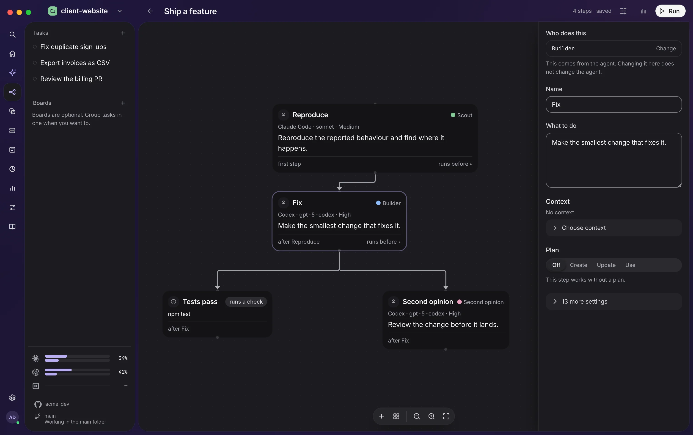

A check step has the **Command to run**, **Counts as passed when the output contains**, **Tests
this check must confirm**, **Heavy work** for checks that build a lot, **Run this check with full
access**, **Run this check on its own** and **If this check does not pass**.

**Workflow settings** in the header opens a side panel with **Files in fresh copies** — which files
a fresh copy brings along — **Protect working copies** and the workflow's context.

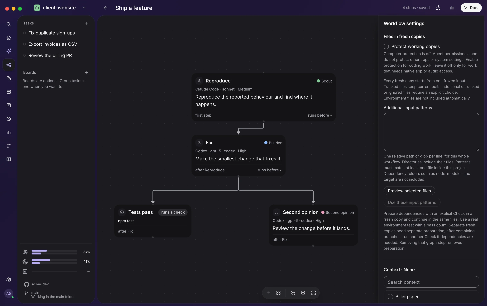

### Order and parallel branches

Order comes from the arrows. Two steps that wait for the same step start together, because the
engine really does start them together. Loops, conditional paths and retries are part of the graph,
not the engine.

Steps can also create, update or read one shared, versioned plan. Implementation and review then
work to the same recorded acceptance contract. In a Rust project, a step copy brings along — read
only — the sibling repositories the project reaches through a Cargo path dependency, so it builds as
the project does.

## Overview

**Overview** (G P) shows the open project on one page: how easily agents find their way in it, who
works, how, and what they know. **Open in Cursor** — or whichever editor you have: Visual Studio
Code, Cursor, Zed, WebStorm or IntelliJ IDEA — opens the project in your editor; the arrow beside
it picks another one. Tabs at the top split the page:

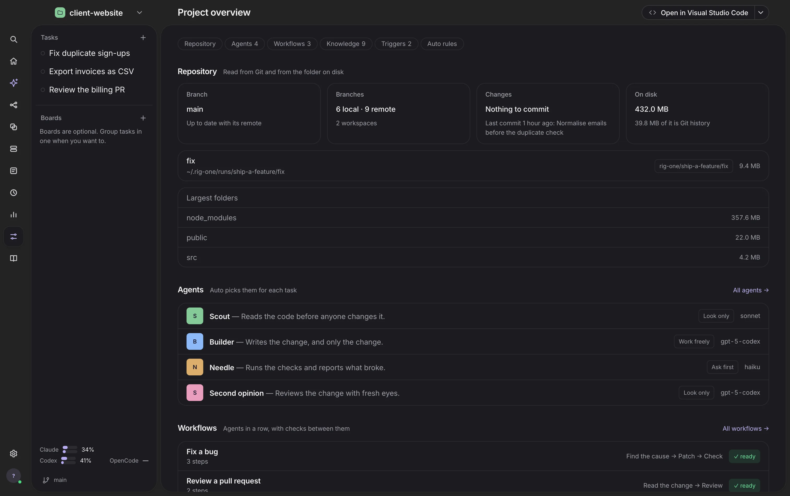

- **Summary** — six tiles, **Score**, **Agents**, **Workflows**, **Knowledge**, **Changes** and
  **Triggers**, each with a number and a note; click one to open its tab. Below them, **Needs your
  attention** lists workflows that need a change, new lessons to review, what the knowledge health
  check found and the weakest point of the score. When nothing is listed, it says "Nothing needs you
  right now."
- **Score** — how easily agents move through this project; see [Score](#score).
- **Repository** — read from Git and from the folder on disk: **Branch** and whether it is up to
  date, **Changes** left to commit with the last commit, local and remote **Branches** with each
  workspace, the size **On disk** with how much is Git history, and the **Largest folders**.
- **Agents** — every agent with its file access and model; click one to open it, or **All agents**.
- **Workflows** — each with its chain of steps and **ready**, **needs a change**, a **Fix** button
  when steps use an agent the project no longer has, or **Fix automatically**.
- **Knowledge** — **Always in context** (the project's instruction files, such as `AGENTS.md` and
  `CLAUDE.md`, with their sizes), **Skills**, and **Lessons from runs** with **Review them**,
  **Keep** or **Discard**.
- **Automation** — the triggers, what starts on its own and whether it is on, and the Auto rules:
  whether Auto agents have your access, the **Learn from runs by default** switch and **All Auto
  settings**.

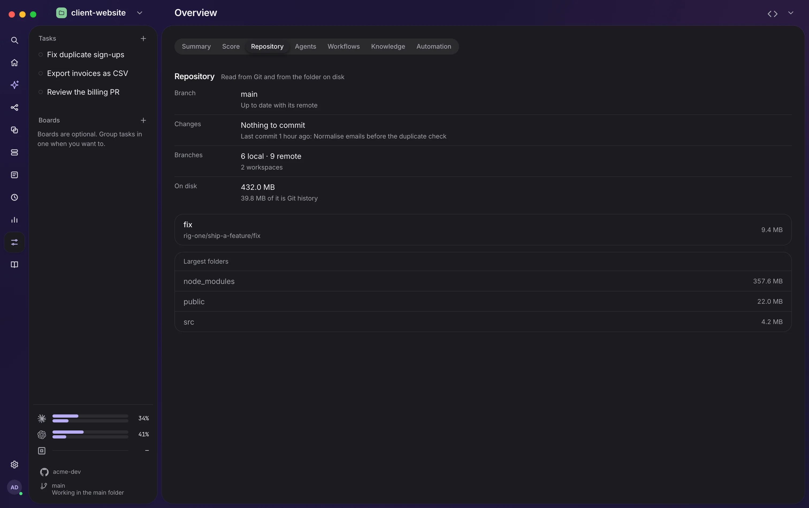

Score and Repository appear only when a folder is open, and Score is hidden when it is turned off
in [Settings → Score](#score-settings).

### Score

**Score** reads the project and rates, out of 100, how easily agents move through it: whether they
find where things live, check their work quickly and understand what went wrong. The criteria are
made for this project, between four and ten of them, so a web app and a command-line tool are not
judged by the same list.

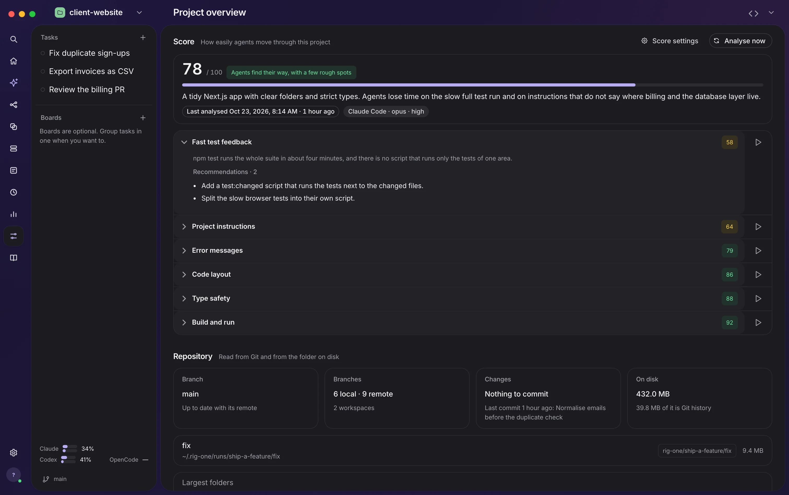

Until a project has been analysed, Score says **No score yet**. **Analyse project**, or **Analyse
now** at the top of the section, starts the analysis; **Analyse now** also runs it again later.

- **Who analyses** — on **Auto**, RigOne picks the strongest agent app, model and effort you have;
  [Settings → Score](#score-settings) can choose Claude Code or Codex instead. The analysis runs in
  the app language.
- **It only reads** — the agent may only read and search files. Nothing in the project is changed.
- **While it works** — a timer, which app, model and effort it uses, how many files it has read and
  **What the agent is doing**. It can take a few minutes. **Stop analysis** stops it, and after 20
  minutes it stops on its own; either way nothing is saved and the last score stays.
- **The score** — the number out of 100 with a verdict, from **Agents move through this project
  without friction** (90 and up) through **Agents find their way, with a few rough spots** (75 and
  up) and **Agents get stuck in several places** (50 and up) to **Agents struggle to find their way
  here**. Below it are a summary, **Last analysed** with when it happened, and the app, model and
  effort that did it.
- **Criteria** — weakest first, each with its own score: green from 75, amber from 50, red below.
  Open one for what the agent found and its **Recommendations**.
- **Run a fix** — the ▷ button beside a criterion opens a new task, **Fix: <criterion>**, and hands
  the Lead the finding and recommendations to fix in this project and then check.

The last analysis is kept in `.rig-one/score.json` inside the project. The Score tile on the
Summary tab opens it, and **Score settings** opens [Settings → Score](#score-settings).

### Generate project setup

**Generate project setup** — the sparkle button in the rail — reads your repository and proposes a
rig: "The lead agent analyzes the project in a conversation, then writes its skills, project
context and agents." The dialog has three tabs:

- **Instructions** — **Your guidance for the lead agent** (optional), and the three stages:
  **Understand the project**, **Build the setup** and **Check and refine**.
- **Files** — what setup wrote, once it has written something.
- **More options** — **Refresh models**, **Review skill updates**, **Review manual edits** and the
  projects RigOne found in the folder.

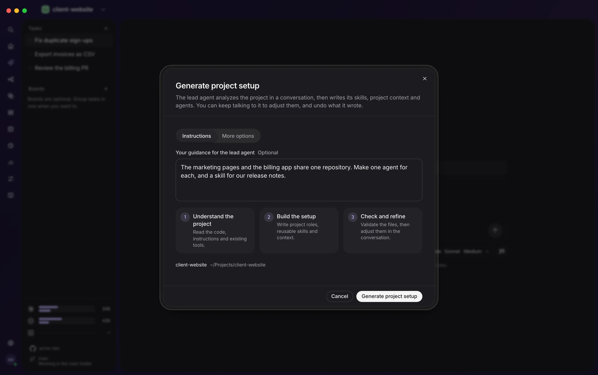

Press **Generate project setup** to start. Setup runs in a lead conversation with the project's
default agent app and model, so you can adjust the files by talking to it, and **Undo** brings back
the files from before the conversation. When it is ready, **Review your project setup** shows every
file it would write. Nothing is applied until you choose **Apply setup**.

## Lab

**Lab** (⌘7) lets you measure an agent, a skill or a workflow on cases from your own code. Sets are
listed by kind in the tabs **Agents**, **Workflows** and **Skills**; click a set to open it on its
own page (**Lab › the set's name**). **Evaluate** on an agent or a skill, or **Evaluate workflow**
in the workflow editor, starts a set for it.

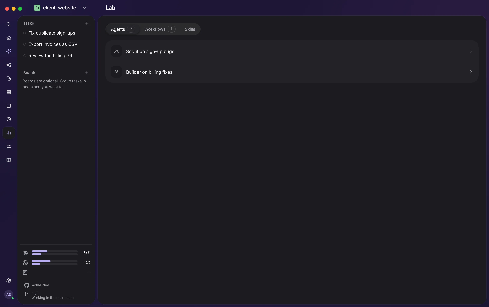

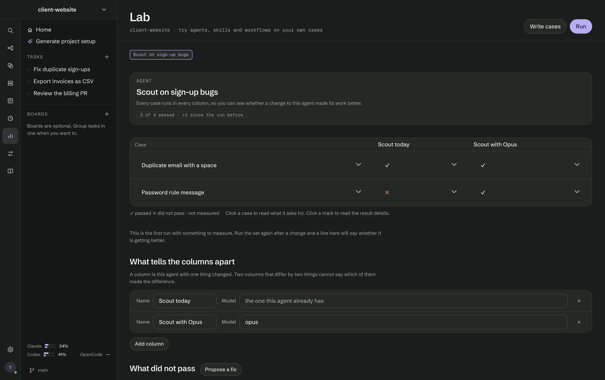

- **Write cases** — the agent reads this project and drafts cases; **Accept** or **Discard** each
  under **Waiting for you**. While it writes, the button becomes **Stop**.
- **Columns** — every accepted case runs in every column; **What tells the columns apart** adds,
  names and removes them. A column is the agent with one thing
  changed, such as the model, so you can see whether the change made its work better. A skill set
  compares the work with and without the skill; a workflow set compares whole workflows on the same
  cases and starting files.
- **Run** — measures every case in every column. A mark reads **passed**, **did not pass** or **not
  measured**; click it for the details and the measured run.
- **What did not pass** — **Propose a fix** suggests new instructions for the agent, which you
  **Apply** or **Discard**.

## Knowledge

**Knowledge** (⌘5) holds what agents take into their prompts. **Health** at the top says how it is
doing; below it, each kind of knowledge has its own tab: **Waiting for you**, **Always in context**,
**Used when they fit**, **What agents passed to each other** and **Earlier project notes**. The page
opens on **Waiting for you** when something waits there, and on **Always in context** otherwise.

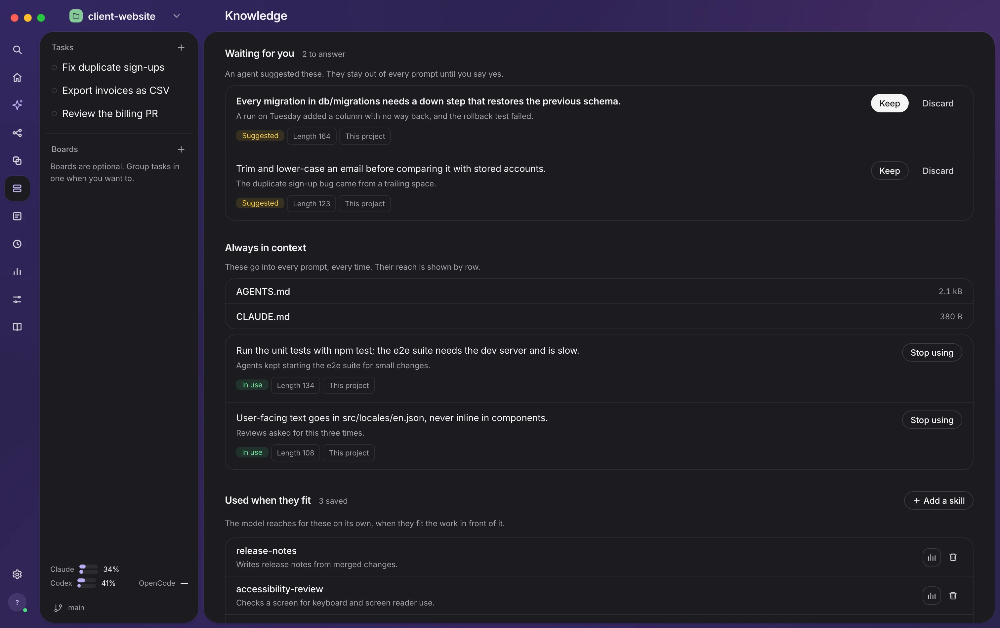

### Health

**Health** says how much every prompt carries — aim for under 40 KB — and either "Knowledge is in
good shape" or how many things to look at, grouped as **Too much** (too many skills, notes too long
for a prompt, files near the size limit), **Out of date** (notes unchanged for months, suggestions
waiting for weeks) and **Not pulling its weight** (duplicate notes, notes learned once long ago,
skills without a description). Some findings offer **Take out of prompts** or **Review them**. The
same verdict shows in **Needs your attention** on the [Overview](#overview).

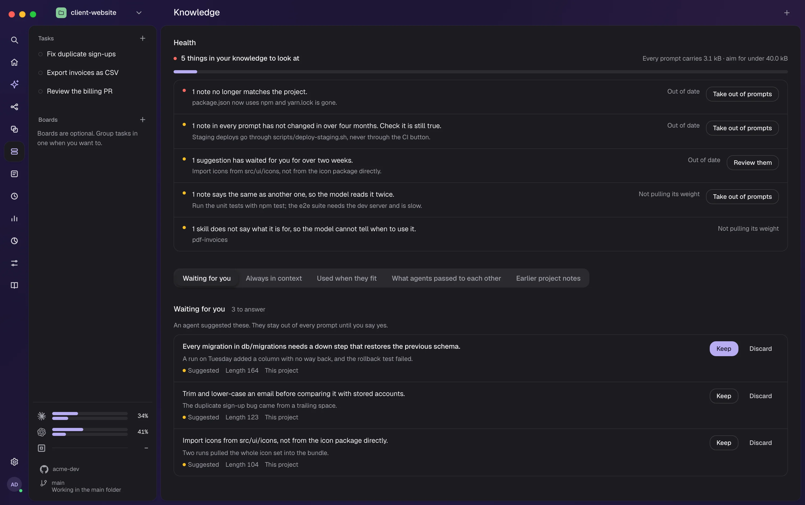

### Waiting for you

Notes an agent suggested stay out of every prompt until you say yes. Each shows the rule, why it
was suggested, its length, its reach — this project, every project or one agent — and the run it
came from. **Keep** puts it to use; **Discard** asks once and it does not come back, even if an
agent learns it again. Leave **Learn from this run** on and RigOne keeps up to three suggested
notes from each run. **Review them** on the Overview opens this tab showing only the new lessons,
with **Show everything** to see the rest.

### Always in context

The project's instruction files and the notes in use go into every prompt, every time. **Stop
using** takes a note out. When memory is full, RigOne asks which note to stop using first.

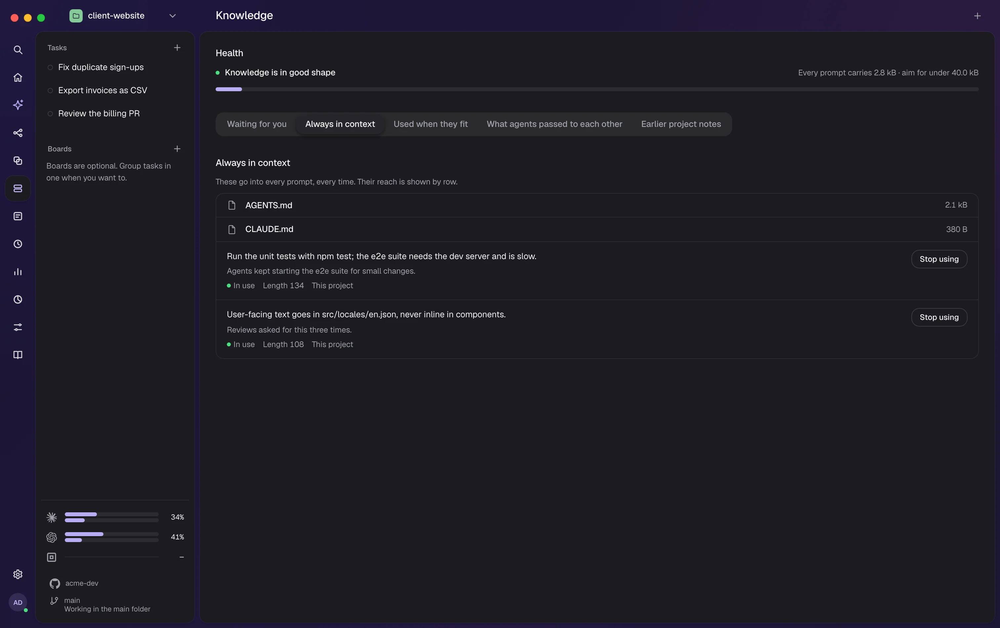

### Used when they fit

Skills are used by the model when they fit the work. **Add a skill** in the header takes a **Link**
to read, a skill you write yourself — what it is called, when to use it, what it should do — or a
sentence for an agent to write it from (**Write it for me**). A new skill goes into this project's
skill folders. Each skill can be evaluated in the Lab or removed from this project.

### What agents passed to each other

The handoffs agents left for each other as steps finished. They are plain files on disk; open them
anywhere.

### Earlier project notes

Notes kept from before this project had its own library. **Move to this project** brings one in.

## Context

**Context** (⌘6) holds named sets of material an agent works from: notes, requirements, screenshots,
PDFs and text files.

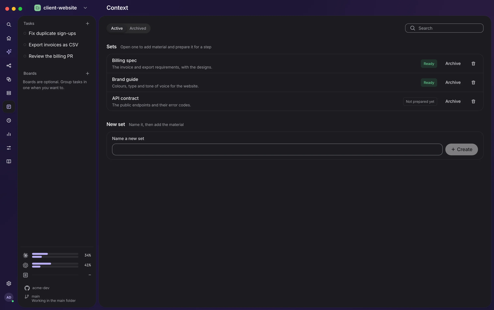

### Sets

**Active** and **Archived** switch shelves, and **Search** filters them. Each set says **Ready** or
**Not prepared yet**, with **Archive** (**Restore** on the Archived shelf) and **Delete**, which
asks first. Name a new set and press **＋ Create**.

### Building a set

Open a set to add material: paste text or a screenshot into **Material**, or **Add files** —
images, PDFs and text files. A PDF or image may need **Prepare** first. **Options** set the
set's name, what the context is for, how the agent should organise it, rules to keep exactly, and
whether Claude Code or Codex builds it, with an optional model. **Build context** reads the material
and organises it into topics, findings, questions and conflicts; while it builds, the same button
stops it, and once a version exists it reads **Rebuild context**. You can correct a finding, **Add a
correction for the next build** and **Save as a new version**.

### Using a set

Attach a set to individual steps, share it across a workflow, or use it in a conversation with the
Lead through **Context** under the message field. A run keeps the version it started with; building
the set again does not change what an existing run receives.

## Skills

**Skills** shows the skills the open project gives its agents, read from `.claude/skills` and
`.agents/skills`. It is read-only: change a skill in its files.

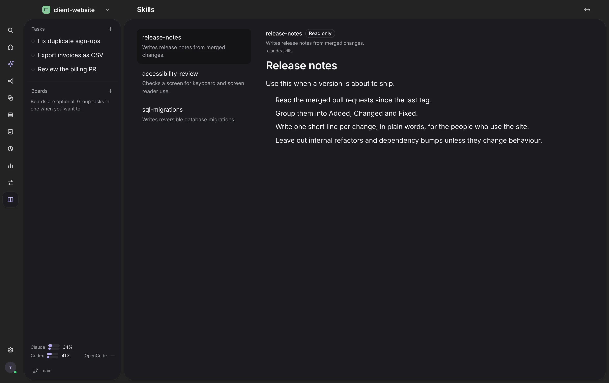

The list on the left names each skill with its summary; the reader on the right shows its
`SKILL.md`, rendered, and the folders it comes from. A skill is a folder with a `SKILL.md` file. To
add a skill to this project, use **Add a skill** in [Knowledge](#knowledge).

## Settings

**Settings** (⌘8) opens over the window. Its pages come in five groups:

| Group | Pages |
| --- | --- |
| **Work** | Runs, Auto, Limits |
| **Project** | Project, Score, Connections |
| **Agents** | Agent apps, and one page each for Claude Code, Codex and OpenCode |
| **Account** | Account, GitHub, Remote access |
| **App** | Appearance, Storage, Health check, About |

### Runs

Spending, history and planning defaults for every run:

- **Spending** — **Warn about spending** (off by default) and the **Default budget warning $**.
- **Planning** — **Minutes for task planning**.
- **History** — **Past runs to keep per project** (zero keeps every run) and **Learn from runs by
  default**.

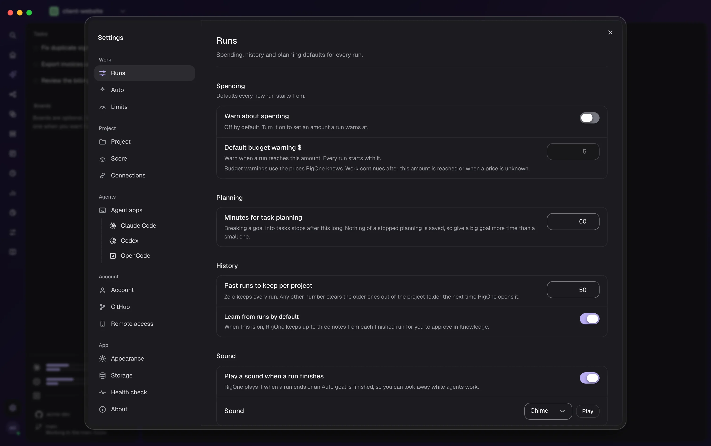

### Auto

What Auto may do on this computer. Under **Access**, **Full access for agents (YOLO)**, **Review the
design before interface changes are recorded** and **Resume goals after RigOne restarts** are all
on by default; see [Full access](#full-access), [Needs you](#needs-you) and [Auto](#auto). **Allowed
credential files** lists credential files steps may read,
one absolute file path per line, such as a private registry `.npmrc`. A step may send what it reads
to the company running the model, so allow only a file you trust every step to read. **Save
exceptions** keeps the list.

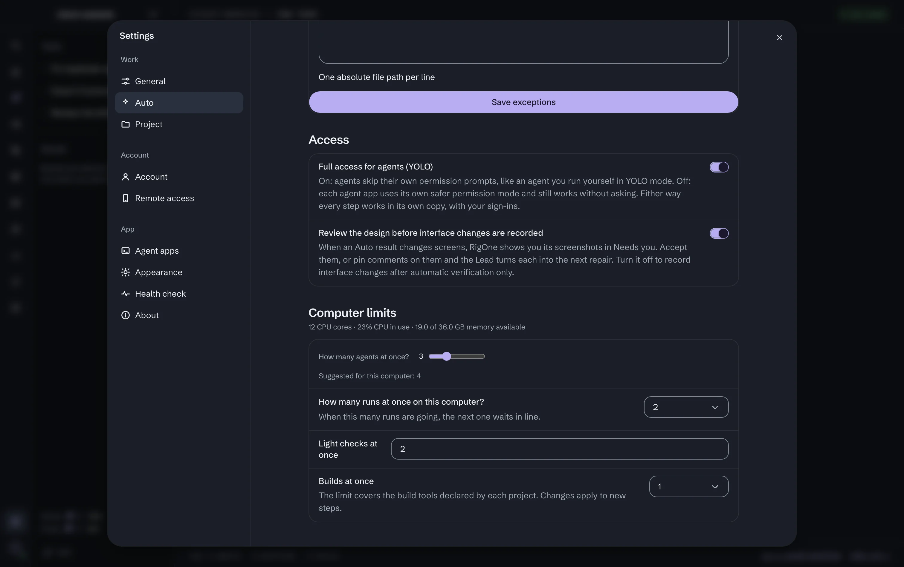

### Limits

**Computer limits** shows the CPU in use now and sets how much work runs at once on this Mac, with
a suggestion for this computer where there is one:

- **How many agents at once?** — the same number as **Agents** in a run's **Run options**.
- **How many runs at once on this computer?** — when this many runs are going, the next one waits
  in line.
- **Light checks at once** and **Builds at once**, or **No build limit**.

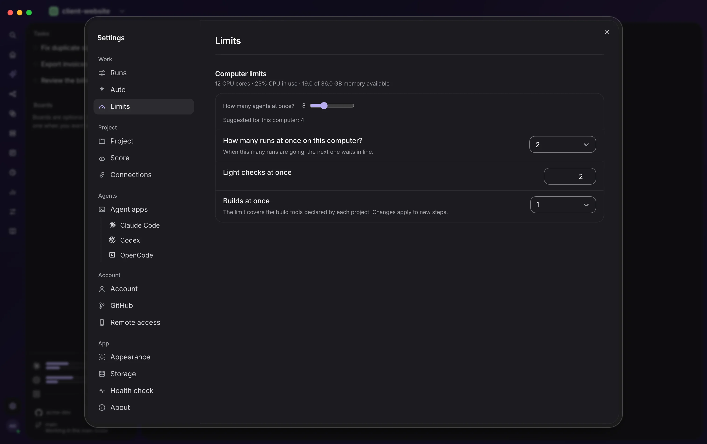

### Project

How conversations start in the open folder:

- **Default conversation** — the agent app (Claude Code, Codex or OpenCode, each with its mark),
  model, effort and speed for new conversations.
- **Project instructions** — whether steps and the Lead read `AGENTS.md`, `CLAUDE.md` and similar
  files as text, with their sources and limits. Private `CLAUDE.local.md` files are left out unless
  you include them.

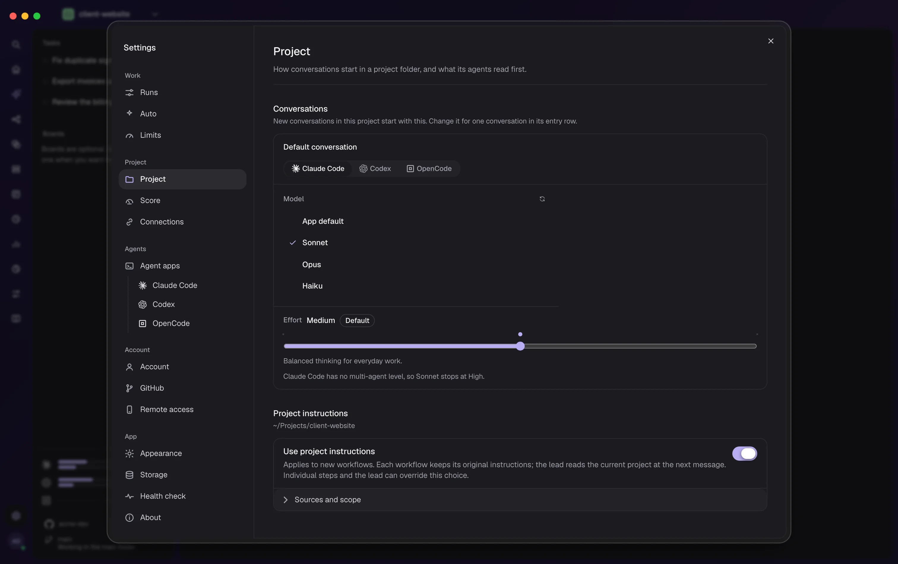

### Score settings

**Score** in Settings sets how projects are scored; see [Score](#score) for what the analysis does.

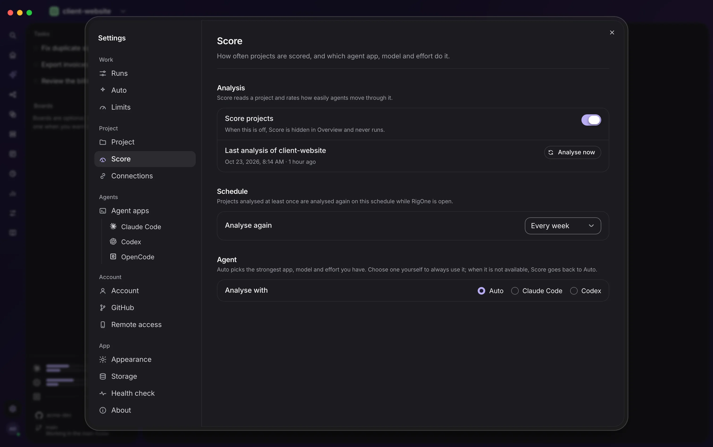

- **Analysis** — **Score projects** is on by default. When it is off, Score is hidden in Overview
  and never runs. **Last analysis of** the open project says when it was analysed, with
  **Analyse now**.
- **Schedule** — **Analyse again**: **Only when I ask** (the default), **Every day**, **Every week**
  or **Every month**. Projects analysed at least once are analysed again on this schedule while
  RigOne is open.
- **Agent** — **Analyse with**: **Auto**, Claude Code or Codex, with the model and effort when you
  choose an app. If the chosen app is no longer available, Score goes back to Auto and says so.

### Connections

The tool servers enabled for new conversations in this project, each with its own switch.
Changes in your Claude Code or Codex settings are not imported on their own: **Import connections**
brings new ones in, and **Refresh list** reads the list again. A change applies to the next
conversation you start; existing conversations keep their connections.

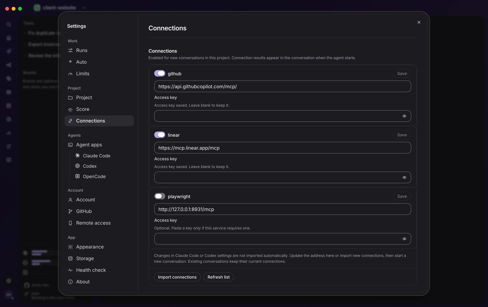

### Agent apps

**Updates** shows the installed and newest version of each app with **Update** and **Update all**.
RigOne updates an app only when no run or conversation is using it, and with **Update automatically
when idle** it looks at most every six hours. **Editor** picks the app that the **Open in** button
on [Overview](#overview) opens.

**Model gateways** — your own address for an agent to go through, in Anthropic or OpenAI shape.
The access key is kept in `~/.rig-one/env`, never in the agent file.

Claude Code, Codex and OpenCode each have a page of their own, listed under Agent apps with their
marks. **Setup** has the **Use Claude Code** (or Codex, OpenCode) switch, the version it answered,
how it is signed in, its **Default model**, **Model services**, its **Tool servers** — **Add to this
project** copies one into the project — **Plugins**, and the **Files RigOne read**, with **Read
again**. **Usage** shows how much of the signed-in plan is used, with **Refresh** and a link to the
account's limits page; OpenCode does not report plan limits. OpenCode's page also edits its
settings file and lists **OpenCode models**.

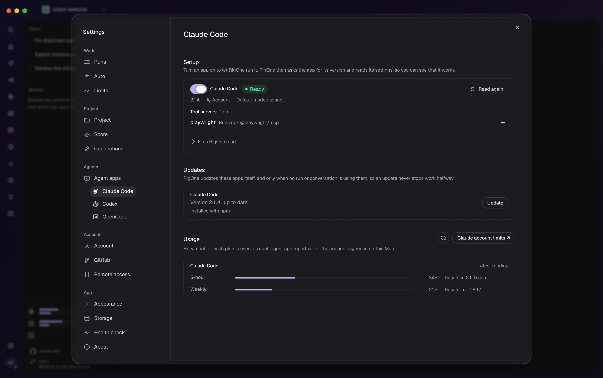

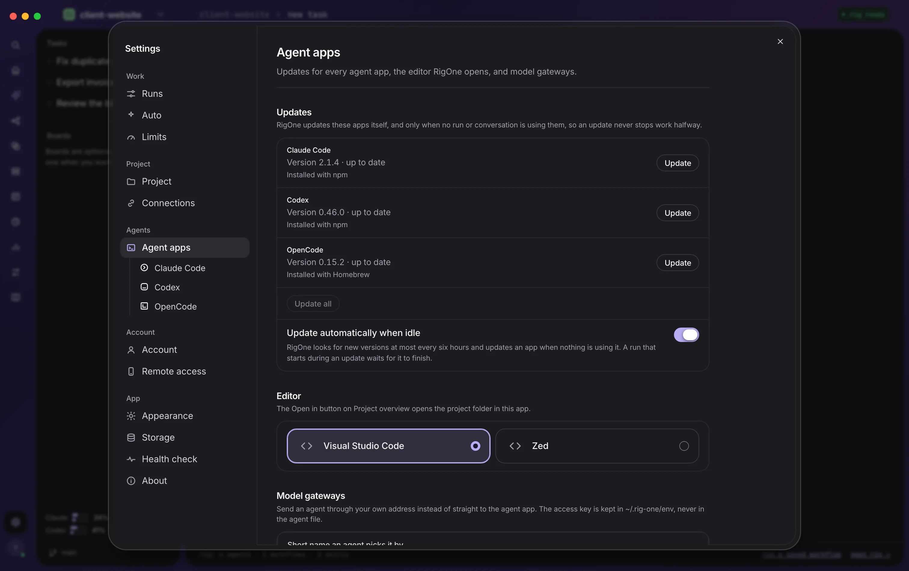

### Account

The MonoOne account that Boards and Remote access use, with two-step sign-in. Your local work
stays on this Mac either way.

### GitHub

The GitHub account RigOne uses for this project, as `gh` knows it on this Mac: **Username**,
**Name**, **Account type**, how it is **Signed in through**, its **Permissions**, the account for
this project and the accounts **Signed in on this Mac**, with **Open on GitHub** and **Refresh**.
The side panel shows the same account for the folder you work in.

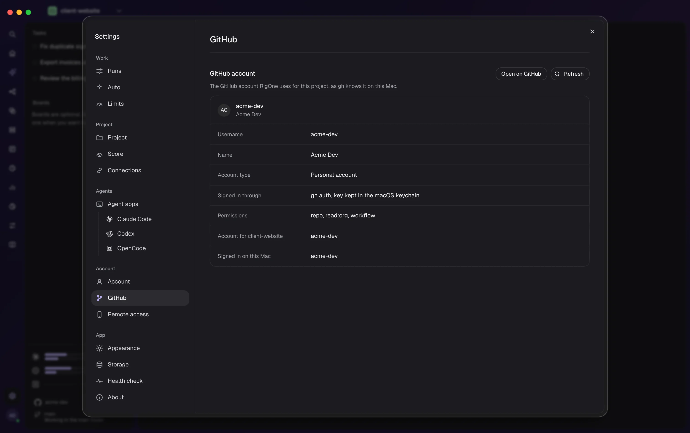

### Remote access

Pair a phone or tablet and choose what it may reach. See [Remote access](#remote-access).

### Appearance

The **App language**; the theme — **Surface** (the default), **Minimalist**, **Studio**, **Linen** or
**Feather** — each in **System**, **Light** or **Dark** under **Light & dark**; an **Accent color**
— **Violet** (the default), Blue, Teal, Green, Orange or Pink; and the **Conversation view**:
**Terminal** or **Agent chat**. Surface is a roomy slate canvas with floating white cards; it draws
the window as islands on glass, and **Window transparency** sets how much of your desktop shows
through. Feather has light type, hairline edges and compact controls.

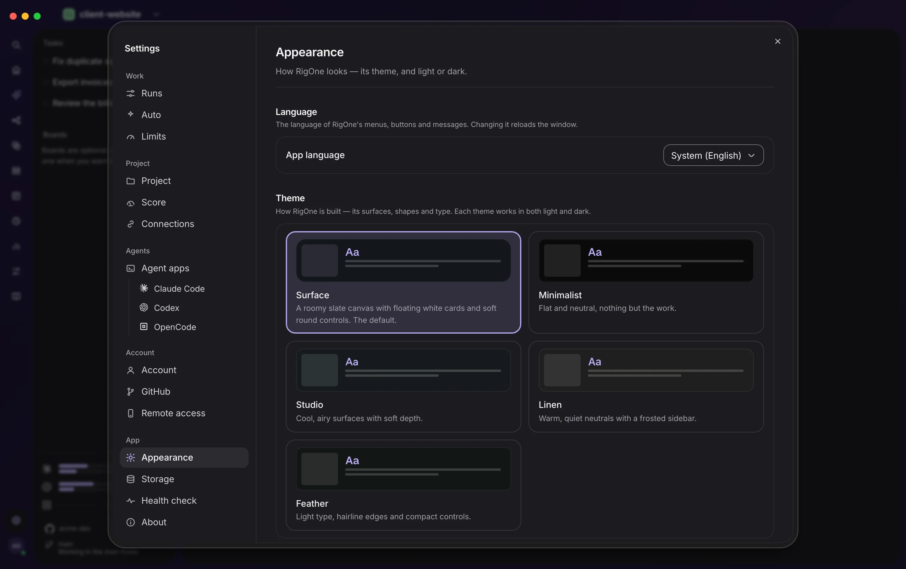

### Storage

How much disk space RigOne uses, and what it can clean up. Each part is listed with its size:
step copies, installed packages and build files, evidence, Lead workspaces, what runs started from
and shared dependencies, with the free space left on the disk. The page shows the last measurement
at once and measures again in the background. It says how much can be cleaned now, and **Clean
now** removes what builds can make again. RigOne also cleans up by itself after runs, and
sooner when the disk runs low.

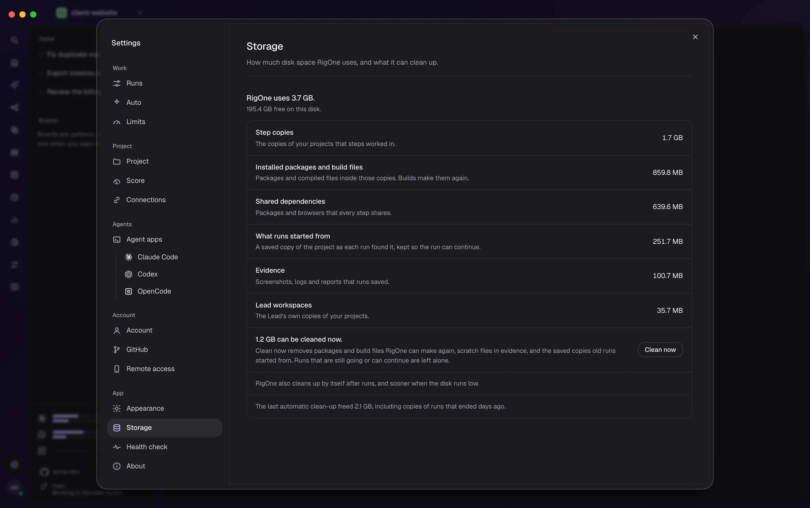

### Health check

Whether everything RigOne needs is working: each agent app and its sign-in, the app new
conversations start with, Git, the GitHub CLI, RigOne's own files, this project and free disk space.
Each row reads **OK**, **Attention**, **Problem** or **Optional**, and a problem comes with a button
to the place that fixes it. **Run again** checks once more.


### About

The version you run and the newest one, **Download the latest version**, which opens the latest
release in your browser, and **Copy diagnostics** for a bug report. How much of each plan is used is
on each agent app's own page.

## Remote access

Remote access lets you follow and steer your work from a phone or tablet. It needs your MonoOne
account and works while RigOne runs on your Mac.

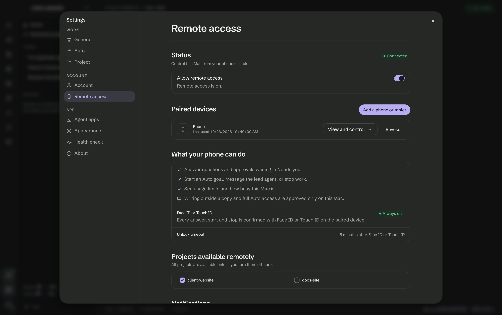

### Pair a phone

1. Sign in under **Settings → Account**.
2. In **Settings → Remote access**, turn on **Allow remote access**.
3. Press **Add a phone or tablet** and scan the code with the phone. On iPhone, add the remote page
   to your Home Screen first, then use **Copy link** on the Mac and paste the link in the Home
   Screen app.
4. Check that the codes match on both screens, choose **View and control** or **View only**, and
   press **Allow**.

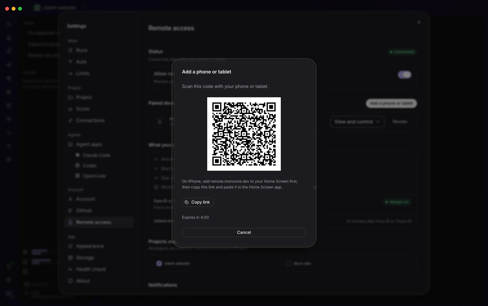

While Remote access is on, a phone icon in the rail shows whether it is connected.

### What your phone can do

The remote app opens on **Start** and moves between **Projects**, **Conversations**, **Work**,
**Planner**, **Boards**, **Needs you**, **Limits**, **Computer** and **This device**:

- Answer questions and approvals waiting in **Needs you**.
- Start a **New conversation** or a **New Auto goal**, message the Lead, or stop work.
- Review a task list in **Planner** and press **Run selected tasks**; you confirm it with Face ID or
  Touch ID.
- Read your boards and comment on their tasks.
- See usage limits and how busy this Mac is.

A message you are writing is kept on the phone if the connection drops. Face ID or Touch ID is
always on, and the unlock lasts 15 minutes from Face ID. Writing outside a
copy and full Auto access are approved only on the Mac.

### Devices, projects and notifications

Each paired device shows when it was last used, its access and **Revoke**. **Projects available
remotely** turns single projects off. **Show question text in notifications** is off by default,
and **Keep this Mac awake for remote access** keeps it reachable on power, or on battery while work
is running. **Activity** lists every remote action. Turning Remote access off ends every device's
access at once.

## Updating

RigOne does not install its own updates. **Settings → About** shows your version and the newest
one, and **Download the latest version** opens its release. To update,
download the new DMG from the
[latest release](https://github.com/monoone-dev/rig-one-landing-page/releases/latest) and replace
the app in Applications. Your library and project folders stay where they are. What changed in each
version is in the [changelog](https://rig-one.io/changelog/).

Claude Code, Codex and OpenCode are another matter: RigOne can update them for you in **Settings →
Agent apps**, only when nothing is using them.

After an update that changes Remote access, the release notes say so; remove the old phone in
**Settings → Remote access** and pair it again.

### Coming from Loadout

Loadout is the earlier name of RigOne. Version 1.1.0 moves your data on first launch:

- `~/.loadout` becomes `~/.rig-one`, with agents, workflows, context sets, settings, prices and the
  whole run history.
- Each project folder's `.loadout/` becomes `.rig-one/` the first time you open it.
- If both names already exist, nothing is touched and the log says so.

macOS sees RigOne as a new application, so permissions start over and the old **Loadout.app**
stays in Applications as a separate app. Delete it once your library has arrived. Releases before
1.1.0 cannot update into it: install 1.1.0 from the DMG.

## Files on disk

| What | Where |
| --- | --- |
| Your library: agents, workflows, skills, notes, triggers, context sets, settings | `~/.rig-one/` |
| Access keys for model gateways | `~/.rig-one/env` |
| A project's own notes, its run history and its last score | `.rig-one/` inside the project folder |
| One run: plan, status, handoffs, full answers, logs and results file | `.rig-one/runs/<time>__<id>/` |
| The search index | `.rig-one/rig-one.db` — safe to delete; it is rebuilt from the files |

A project's `.rig-one/` folder is plain files and safe to commit. Agents, workflows and notes are
Markdown and JSON, so they diff cleanly in Git.

Step copies, their installed packages and build files, and the evidence runs saved take disk space
of their own. **Settings → Storage** shows how much each part uses and cleans what builds can make
again. Steps share one Playwright browser folder, so one copy never deletes browsers another
installed.

Board keys are kept in the macOS Keychain.

**Copy diagnostics** in **Settings → About** copies a diagnostic summary for a bug report. Read it
before you share it.

## Uninstall

1. Quit RigOne and move `/Applications/RigOne.app` to the Trash. Your library stays.
2. To remove your data too, delete `~/.rig-one/` and the `.rig-one/` folders inside your projects.
   **This permanently deletes your agents, workflows, notes and run history.** The branches runs
   left in your repositories are ordinary Git branches; delete them with Git if you no longer need
   them.
3. If you used Remote access, revoke your devices in **Settings → Remote access** first.

## Troubleshooting

**An agent app is not ready.** Open **Settings → Health check**. Run `claude`, `codex` or
`opencode` once in Terminal to check that it is installed and signed in, then press **Run again**.
An app turned off on its own page in **Settings**, under **Agents**, stays off until you switch it
on. If you have more than one OpenCode install, RigOne runs the newest.

**Couldn't access your sign-in in Keychain.** Sign in again, and allow access when macOS asks for
it.

**A run refuses to start and names a step.** Read the reason on screen: usually a model or effort
level your agent app no longer offers, a connection that is turned off, or a step that must save a
plan but may only look. Fix the step and start again.

**Nothing happened after I pressed Enter in the command bar.** The Lead talks and prepares; only
`/run` starts work, or a goal in Auto.

**A step cannot read a credential file outside its copy.** Every step works in its own copy. Add a
file it really needs, such as a private registry `.npmrc`, to **Credential file exceptions** in
**Settings → Auto**.

**A step seems to wait for nothing.** An agent may be waiting for its own background work, such as
a long build. RigOne does not stop the step early; it waits for the agent to finish that work, as
the same agent would in a terminal.

**Auto is waiting and nothing moves.** Open **Needs you**: a question or a design review may be
waiting. A step that waits says what for — a free place, memory, a Rust build or a usage-limit
reset. A goal may also wait for a condition the Lead set; the stream says what and until when. Up
to three goals work in one folder at a time; a fourth waits its turn.

**Boards or Remote access says sign-in is required.** They are the only parts that need an
account. Sign in from **Settings → Account**; the rest of RigOne works without one.

**My phone shows the pairing screen again.** Remove the phone in **Settings → Remote access** and
pair it again, in Safari on iPhone.

**Something else.** [Open an issue](https://github.com/monoone-dev/rig-one-landing-page/issues/new)
with your RigOne version, macOS version and what you expected. Issues are public: never paste API
keys, private code or a diagnostic summary you have not read.
